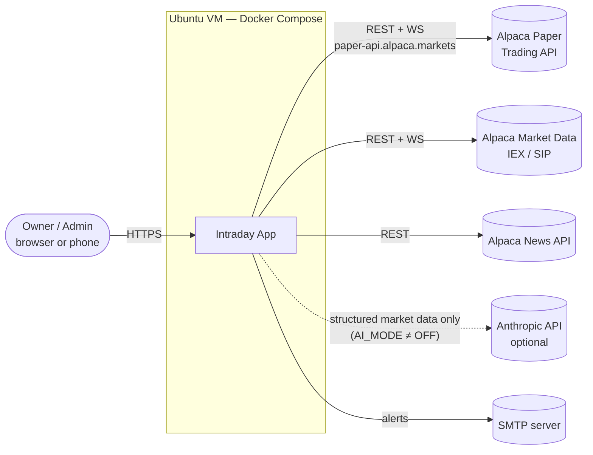
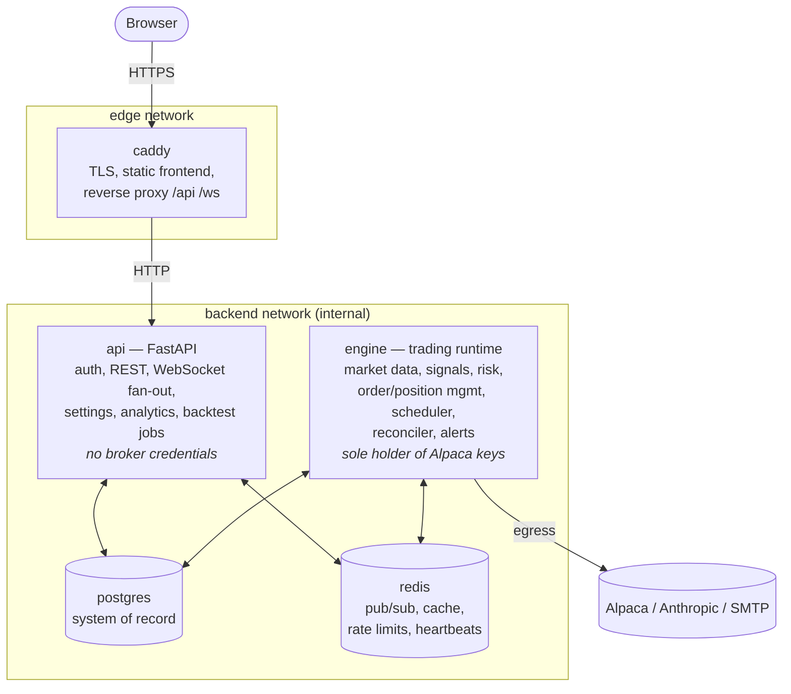
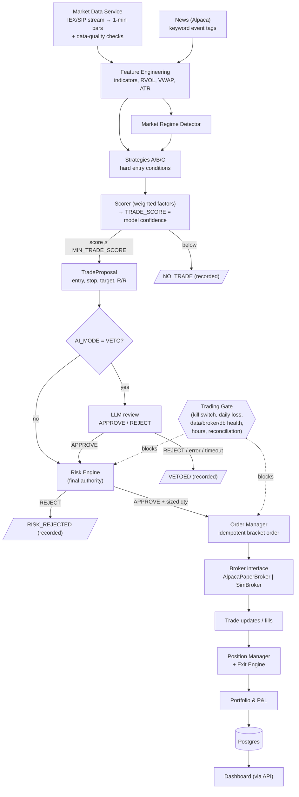
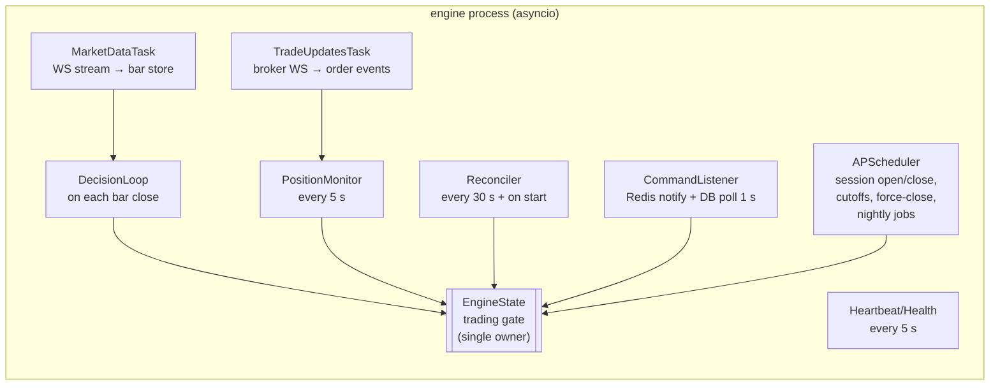

# 01 — Architecture

## 1. Guiding principles

1. **Paper only, enforced twice.** The engine checks the configuration at boot, and the broker client factory checks it again when constructing the client. Neither check depends on the UI.
2. **The deterministic risk engine has final authority.** Nothing upstream of it, including the scorer, strategies and LLM, can place an order.
3. **Fail closed for entries, fail safe for exits.** Any doubt blocks *new* trades. Existing positions stay protected by broker-side bracket stops, and the engine keeps managing them.
4. **Everything is explainable from stored data.** Each step in the pipeline writes an immutable record keyed to the one before it.
5. **One code path for live, replay and backtest.** Strategy, scoring and risk code never know which data source or broker they're running against.
6. **Separate processes for separate failure domains.** An API crash never interrupts position management.

## 2. System context

## 3. Containers

| Container | Responsibility | Must survive the other failing? |
|---|---|---|
| `caddy` | HTTPS (Let's Encrypt), serves built React app, proxies `/api/*` and `/ws` | — |
| `api` | Auth, REST, WebSocket fan-out, settings CRUD, analytics queries, backtest job runner, writes engine commands | Yes. If the engine is down, the API reports it and still serves history. |
| `engine` | Everything that touches the market or the broker | Yes. If the API is down, trading and position management continue. |
| `postgres` | System of record for audit, orders, positions, settings | If the DB fails, no new trades are opened; brackets keep protecting open positions (§6) |
| `redis` | Real-time event bus, caches, rate limiter, heartbeats | Nothing critical depends on it. The engine falls back to DB polling. |

The API has no Alpaca keys. Account figures come from snapshots the engine writes to Postgres and publishes to Redis. User actions that touch the broker (close position, close all, emergency stop) become **engine commands**.

## 4. Decision pipeline (SPEC §2, as built)

The trading gate is checked twice: inside the risk engine and again immediately before order submission. An emergency stop that arrives between those two checks still takes effect.

## 5. Engine process model

The engine is a single asyncio process. Its long-lived tasks are supervised: if one crashes it is restarted with backoff and raises an alert, and a crash of the risk task itself triggers `RISK_ENGINE_ERROR`.

Concurrency rule: every read or write of portfolio state that feeds a sizing decision happens under one `asyncio.Lock` (the "portfolio lock"). A proposal is sized against a consistent snapshot that includes **pending** entry orders.

## 6. Failure domains and fail-safe behaviour (SPEC §27)

| Failure | Detection | New entries | Existing positions | Recovery |
|---|---|---|---|---|
| Market data stale (SPY/QQQ bar age > `DATA_STALE_SECONDS`) | MarketDataTask / heartbeat | Blocked `DATA_STALE` | Brackets remain; engine exits continue using REST quotes | Auto-clears when fresh for 2 consecutive bars |
| Single symbol stale or poor-quality | Quality checks | That symbol excluded | Managed via REST quotes | Auto |
| Broker API errors / WS down | Error rate, WS state | Blocked `BROKER_DOWN` | Brackets live at broker | Auto after successful reconcile |
| Database down | Write failure / health probe | Blocked `DB_DOWN` | Managed; audit events spooled to local JSONL, replayed into DB on recovery | Auto after spool flush |
| AI provider down (VETO only) | N consecutive failures | Blocked `AI_UNAVAILABLE` | Unaffected | Auto after a successful probe |
| Risk engine exception | Exception in evaluate() | Trade rejected + blocked `RISK_ENGINE_ERROR` | Unaffected | **Manual** reset |
| Reconciliation mismatch | Reconciler | Blocked `RECONCILE_MISMATCH` | Broker is truth for qty | **Manual** after review (auto if mismatch self-explains, §08) |
| Daily loss limit | P&L monitor | Blocked `DAILY_LOSS_LIMIT` (latched) | Keep stops (default) or flatten | **Manual** reset |
| Emergency stop | User | Blocked `EMERGENCY_STOP` (latched) | Close all (default) | **Manual** reset |
| Engine restart | Boot | Blocked `RECONCILING` until first reconcile passes | Loaded from broker, never assumed flat | Auto |
| API crash | Container health | n/a | Unaffected (separate process) | Docker restart |
| Engine crash | Heartbeat missing in API | n/a | Brackets at broker protect positions | Docker restart → reconcile |

## 7. Data flow for the UI

- Engine → Postgres: the durable record. Every table in 04.
- Engine → Redis pub/sub `events:*`: real-time deltas (status, positions, orders, decisions, alerts, account).
- API → Browser: a WebSocket forwards Redis events. REST covers history and snapshots.
- If Redis is down, the UI falls back to 5-second REST polling, shown by a banner indicator.

## 8. Security architecture (summary; details in 05, 06, 11)

- Single admin user, argon2id hashing, server-side sessions in an `HttpOnly; Secure; SameSite=Strict` cookie, double-submit CSRF token on unsafe methods, rate limiting on login and globally, and an audit log of every mutating action.
- Secrets live only in `.env` on the VM (mode 600), injected per container. Alpaca and Anthropic keys go to the **engine** container only.
- The browser never receives broker credentials or account numbers beyond the display fields.
- The LLM payload is whitelisted: no balances, no account IDs, no credentials (09 §7).

## 9. Designed for a later AWS move

These boundaries mean a later move to AWS needs no rewrite. `api` and `engine` become two ECS services, Postgres moves to RDS and Redis to ElastiCache, and Caddy is replaced by ALB plus CloudFront. Configuration is 12-factor, and no component assumes it shares a host with another.
