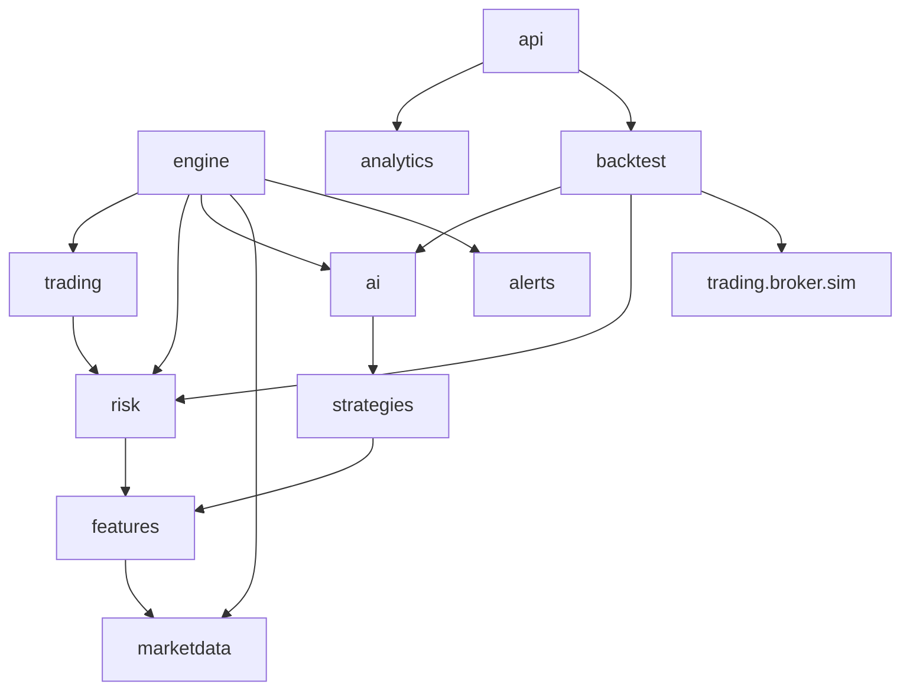

# 03 — Repository Structure

## 1. Tree

```
intraday-app/
├── CLAUDE.md
├── README.md
├── .env.example                 # placeholders only; .env is git-ignored
├── .gitignore
├── .github/workflows/ci.yml
├── compose.yaml                 # production service definitions
├── compose.dev.yaml             # dev overrides: hot reload, exposed ports, vite dev server
├── compose.test.yaml            # ephemeral postgres/redis for integration tests
├── config/
│   ├── defaults.yaml            # seed runtime settings (06) — the "configuration file"
│   └── watchlist.seed.yaml      # tradable stocks (asset_type, country, sector, …) + CONTEXT symbols (SPY, QQQ, sector ETFs, vol proxy)
├── backend/
│   ├── pyproject.toml
│   ├── uv.lock
│   ├── Dockerfile
│   ├── alembic.ini
│   ├── migrations/              # alembic env + versions/
│   ├── importlinter.ini
│   ├── src/intraday/
│   │   ├── core/                # config loading, clock, ids, money, errors, logging, safety (paper guard),
│   │   │                        # assets.py (is_eligible_common_stock, used by universe, risk, order manager)
│   │   ├── db/                  # SQLAlchemy models, session, repositories/
│   │   ├── marketdata/          # market_feed.py, historical.py, bars.py, calendar.py,
│   │   │                        # quality.py, universe.py, news.py
│   │   ├── features/            # indicators.py, feature_engineering.py, regime.py
│   │   ├── strategies/          # base.py, momentum_breakout.py, vwap_reclaim.py, pullback.py
│   │   ├── ai/                  # decision.py (proposal builder), scoring.py, model.py (Scorer iface),
│   │   │                        # explain.py, veto.py, providers/{base,anthropic,openai,local,null}.py,
│   │   │                        # prompts/, validation.py
│   │   ├── risk/                # risk_manager.py, position_sizer.py, limits.py, checks.py,
│   │   │                        # correlation.py, daily_loss.py, gate.py
│   │   ├── trading/             # broker/{base,alpaca_paper,sim,future_live}.py, order_manager.py,
│   │   │                        # position_manager.py, execution.py, exits.py, reconciler.py, liquidation.py
│   │   ├── engine/              # main.py (entrypoint), runtime.py, supervisor.py, scheduler.py,
│   │   │                        # commands.py, heartbeat.py, spool.py
│   │   ├── backtest/            # runner.py, replay.py, metrics.py, splits.py, costs.py
│   │   ├── analytics/           # pnl.py, calendar.py, performance.py
│   │   ├── alerts/              # notifier.py (interface), dashboard.py, email.py
│   │   ├── api/                 # main.py (entrypoint), deps.py, ws.py, security/, routers/, schemas/
│   │   └── cli.py               # `intraday` Typer CLI
│   └── tests/
│       ├── unit/                # mirrors src/intraday/*
│       ├── integration/         # DB, API, engine with fake broker/stream
│       ├── property/            # hypothesis tests for risk/sizing invariants
│       ├── fixtures/            # recorded Alpaca + Anthropic responses, bar CSVs, replay days
│       └── conftest.py
├── frontend/
│   ├── package.json, vite.config.ts, tsconfig.json, tailwind.config.ts
│   ├── src/
│   │   ├── app/                 # router, layout (paper banner, status bar, nav), providers
│   │   ├── pages/               # one folder per page (14, see 10)
│   │   ├── components/          # tables, charts, calendar, controls, confirm dialogs
│   │   ├── api/                 # generated OpenAPI types + client, ws client
│   │   ├── hooks/, lib/
│   └── tests/                   # vitest unit tests
├── tests/
│   └── e2e/                     # Playwright: full stack against replay mode + SimBroker
├── infrastructure/
│   ├── caddy/Caddyfile
│   ├── docker/frontend.Dockerfile   # builds SPA, copies into caddy image
│   ├── scripts/                 # backup.sh, restore.sh, deploy.sh, vm-bootstrap.sh
│   └── systemd/                 # intraday-backup.service/.timer
└── docs/
    ├── SPEC.md
    ├── design/                  # this package
    └── runbooks/                # emergency stop, restore from backup, rotate keys, reconcile mismatch
```

## 2. Mapping to SPEC §30

The spec's top-level folders have hyphens and can't be imported as Python packages (decision G13). They become subpackages of one `intraday` package. The spec's file names are kept where they fit.

| SPEC folder / file | Location |
|---|---|
| `/frontend` | `frontend/` |
| `/backend/{api,services,models,repositories,config}` | `intraday/api`, `intraday/db/repositories`, `intraday/db/models`, `intraday/core/config` |
| `/trading-engine/{broker,order_manager,position_manager,execution}.py` | `intraday/trading/…` (same names) + `intraday/engine/` for the runtime |
| `/risk-engine/{risk_manager,position_sizer,limits}.py` | `intraday/risk/…` (same names) |
| `/ai-engine/{signal_generator,feature_engineering,model,decision}.py` | `intraday/strategies/` (signal generation), `intraday/features/feature_engineering.py`, `intraday/ai/{model,decision}.py` |
| `/market-data/{market_feed,indicators,universe}.py` | `intraday/marketdata/{market_feed,universe}.py`, `intraday/features/indicators.py` |
| `/backtesting` | `intraday/backtest/` |
| `/database` | `backend/migrations/` + `intraday/db/` |
| `/infrastructure` | `infrastructure/` + compose files at root |
| `/tests` | `backend/tests/`, `frontend/tests/`, `tests/e2e/` |
| `/docs` | `docs/` |

## 3. Module boundaries (import-linter contracts)

An arrow means *may import*. Anything not drawn is forbidden. `core` and `db` may be imported by everything and are omitted for readability.



The rules that matter for safety:

| Contract | Why |
|---|---|
| `ai`, `strategies`, `features` **must not import** `trading` | AI and signal code physically cannot reach the broker. |
| `risk` **must not import** `ai`, `api`, `trading.broker` | The risk engine is a pure function of snapshots. |
| `api` **must not import** `trading.broker`, `engine` | The API has no broker access; it only writes commands. |
| Only `trading.broker.factory` may construct `AlpacaPaperBroker` | Single choke point for the paper guard. |
| `backtest` may import `strategies`, `ai.scoring`, `risk`, `trading.broker.sim` but **not** `trading.broker.alpaca_paper` | Backtests can never hit a real endpoint. |

## 4. Entrypoints

| Command | Process |
|---|---|
| `python -m intraday.api.main` (uvicorn) | api container |
| `python -m intraday.engine.main` | engine container |
| `intraday create-admin` | one-off, bootstrap admin user |
| `intraday backfill --days 30` | one-off, pull history for watchlist (run inside engine container, which has the keys) |
| `intraday replay --date 2026-09-21 --speed 60` | runs full engine against recorded bars + SimBroker, into the `intraday_sim` database |
| `intraday reconcile-now` | forces a reconcile and prints the diff |
