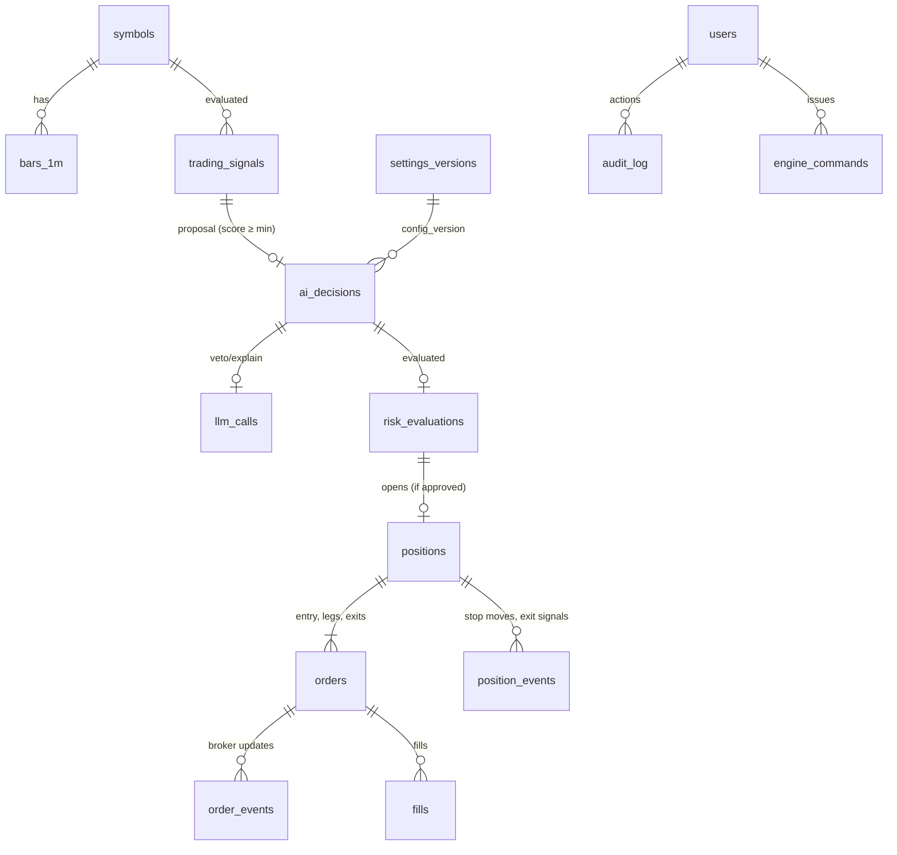

# 04 — Database Schema

PostgreSQL 16. Conventions:

- PKs are `uuid` (v7, time-ordered) unless noted. Bars use natural composite keys.
- All timestamps are `timestamptz` in UTC. `session_date date` is the ET trading date.
- Prices are `NUMERIC(14,4)`, money `NUMERIC(14,2)`, quantities `INTEGER` (whole shares, C1).
- Enums are Postgres `TEXT` + `CHECK` constraints, which are easier to migrate than native enums.
- Audit tables (`*_events`, `ai_decisions`, `risk_evaluations`, `llm_calls`, `audit_log`, `fills`) are append-only. The DB role `engine_rw` has no `UPDATE`/`DELETE` on them.
- Every decision-path row carries `config_version`, so every trade can be tied back to the exact settings in force.

## 1. ER overview (trade audit chain)

This chain covers SPEC §44. The market data is in `trading_signals.features`. The strategy's calculation is in `trading_signals` and `ai_decisions`. The AI's recommendation is in `llm_calls`. The risk engine's verdict is in `risk_evaluations`. The order submitted is in `orders`, the broker's responses in `order_events`, the fills in `fills`, and the exit reason in `positions.exit_reason` plus `position_events`.

## 2. Tables

### Identity and security

**users**: `id`, `email` unique, `password_hash` (argon2id), `role` (`admin`, CHECK allows `viewer` for later), `is_active`, `failed_login_count`, `locked_until`, `created_at`, `last_login_at`.

**sessions**: `id` (random 256-bit, stored as SHA-256 hash), `user_id`, `csrf_token_hash`, `created_at`, `expires_at`, `last_seen_at`, `ip`, `user_agent`, `revoked_at`.

**audit_log**: `id`, `ts`, `user_id` nullable (system), `action` (e.g. `SETTINGS_UPDATE`, `EMERGENCY_STOP`, `LOGIN_FAILED`), `target`, `before jsonb`, `after jsonb`, `ip`, `user_agent`, `result`.

### Configuration

**settings_versions**: `version` serial PK, `config jsonb` (full validated settings document, 06), `created_at`, `created_by`, `comment`, `is_active` (partial unique index: one active). Never updated in place; each save inserts a new version.

### Universe and market data

**symbols** (watchlist + context symbols, D3): `symbol` PK, `role` (`TRADABLE|CONTEXT`), `name`, `asset_type` (`COMMON_STOCK|ETF|OTHER`, entered by hand), `country` (ISO-2, entered by hand), `sector`, `sector_etf`, `market_cap` nullable, `enabled`, `notes`, plus the Alpaca asset cache: `alpaca_class`, `alpaca_exchange`, `alpaca_name`, `alpaca_tradable`, `alpaca_status`, `alpaca_synced_at`; `eligibility jsonb` (last E1–E7 result per rule, 07 §2a), `created_at`, `updated_at`.
**DB guard:** `CHECK (role <> 'TRADABLE' OR (asset_type = 'COMMON_STOCK' AND country = 'US'))`. A trigger on `orders` rejects any `side='buy'` insert whose symbol isn't `role='TRADABLE'`, so a buy for a context symbol like SPY can't even be recorded.
Context symbols (SPY, QQQ, sector ETFs, volatility proxy) are seeded with `role='CONTEXT'`. They get bars and features but never signals or orders.

**bars_1m**: PK (`symbol`, `feed`, `ts`); `open`, `high`, `low`, `close`, `volume` bigint, `vwap`, `trade_count`, `is_updated` (late bar correction). **Regular-session bars only**: Alpaca's historical endpoint also returns pre/after-market bars, which are dropped on ingest. About 30 symbols × 390 × 252 ≈ 3M rows/yr. B-tree on PK is sufficient. Retention: indefinite (backtest source).

**bars_1d**: PK (`symbol`, `feed`, `session_date`); OHLCV, `vwap`.

**market_calendar** *(added in Phase 2, migration 0003)*: `session_date` PK, `open_at`, `close_at` (UTC), `early_close`, `fetched_at`. Source: Alpaca `/v2/calendar`. The API reads it for market status even while the engine is offline.

**universe_scans**: `id`, `scan_id` (groups one scan's rows; migration 0004), `ts`, `session_date`, `symbol`, `passed` bool, `reasons jsonb` (every filter U1–U9: passed, value, limit, detail, evaluated), `metrics jsonb`, `feed`, `config_version`. Retention 180 days.

**news_items**: `id`, `source_id` unique, `symbols text[]`, `headline`, `summary`, `source`, `url`, `published_at`, `event_tags text[]`, `sentiment` (`POSITIVE|NEGATIVE|NEUTRAL|UNKNOWN`), `sentiment_source` (`NONE|LLM`), `fetched_at`.

### Decisions (the audit chain)

**trading_signals**: one row per (symbol, strategy, bar) evaluated.
`id`, `ts`, `bar_ts`, `session_date`, `symbol`, `strategy`, `feed`, `features jsonb` (snapshot of every input used), `conditions jsonb` (each hard condition → bool + value), `factor_scores jsonb`, `score NUMERIC(5,4)`, `regime`, `signals text[]`, `action` (`BUY|NO_TRADE|EXIT`), `note` (e.g. "score below minimum", "superseded by …"; migration 0005), `config_version`.
Retention: `NO_TRADE` rows 90 days; rows linked to a decision kept forever. About 35k rows/day at 30 symbols × 3 strategies.

**ai_decisions** (spec name; one per proposal whose score ≥ `MIN_TRADE_SCORE`):
`id`, `signal_id` FK, `ts`, `symbol`, `strategy`, `market_price`, `action`, `confidence` (= score, D2), `score`, `signals text[]`, `reasoning` (template-rendered explanation), `reasoning_llm` (EXPLAIN/VETO rephrase, nullable), `entry_ref_price`, `stop_loss`, `take_profit`, `risk_reward`, `expected_return`, `estimated_risk`, `holding_period`, `ai_mode`, `llm_verdict` (`APPROVE|REJECT|ERROR|NULL`), `llm_call_id`, `risk_amount`, `decision_result` (`VETOED|RISK_REJECTED|BLOCKED|ORDER_SUBMITTED|ORDER_FAILED`), `block_reasons text[]` (gate reasons when BLOCKED; migration 0005), `config_version`.

**llm_calls**: `id`, `ts`, `purpose` (`VETO|EXPLAIN|NEWS_SENTIMENT`), `provider`, `model`, `request jsonb` (exact payload sent, after whitelisting), `response_raw text`, `parsed jsonb`, `valid` bool, `stop_reason`, `latency_ms`, `input_tokens`, `output_tokens`, `error`.

**risk_evaluations**: `id`, `decision_id` FK, `ts`, `approved` bool, `checks jsonb` (array of `{name, passed, value, limit, detail}`; every check is run and recorded, not short-circuited), `sizing jsonb` (each qty bound: risk, capital, exposure, bp, daily-loss headroom, sector, correlated), `qty`, `position_value`, `stop_price`, `take_profit_price`, `risk_reward`, `max_loss`, `exposure_after`, `open_positions_after`, `daily_loss_worst_case_after`, `gate_blocks text[]`, `config_version`.

### Orders, fills, positions

**orders**: `id`, `client_order_id` unique (idempotency key, 08 §4), `broker_order_id` unique nullable, `parent_order_id` (for bracket legs), `position_id` FK, `decision_id` FK nullable, `symbol`, `side` (`buy|sell`), `intent` (`ENTRY|TAKE_PROFIT|STOP_LOSS|ENGINE_EXIT|FORCE_CLOSE|EMERGENCY_CLOSE|MANUAL_CLOSE`), `type`, `order_class` (`simple|bracket|oco`), `tif`, `qty`, `limit_price`, `stop_price`, `status` (local state machine, 08 §5), `broker_status`, `filled_qty`, `filled_avg_price`, `submitted_at`, `acked_at`, `terminal_at`, `attempts`, `last_error`, `reject_reason`, `raw jsonb` (last broker payload), `created_at`, `updated_at`.

**order_events**: `id`, `order_id`, `ts`, `source` (`STREAM|POLL|RECONCILE|LOCAL`), `event` (`new|partial_fill|fill|canceled|expired|replaced|rejected|pending_cancel|…`), `payload jsonb`.

**fills**: `id`, `order_id`, `broker_execution_id` unique, `ts`, `qty`, `price`, `fee` (0 for Alpaca paper; modeled in backtests), `liquidity`.

**positions** (a round trip, spec's positions + closed_positions): `id`, `session_date`, `symbol`, `status` (`PENDING_ENTRY|OPEN|EXITING|CLOSED|ABANDONED`), `strategy`, `entry_decision_id`, `qty`, `avg_entry_price`, `entry_time`, `initial_stop`, `stop_price` (current), `take_profit_price`, `trailing_active`, `high_water_price`, `risk_amount`, `score`, `avg_exit_price`, `exit_time`, `exit_reason` (`TAKE_PROFIT|STOP_LOSS|TRAILING_STOP|TIME_EXIT|MOMENTUM_REVERSAL|VWAP_LOSS|REGIME_REVERSAL|EOD_LIQUIDATION|EMERGENCY|MANUAL|DAILY_LOSS_FLATTEN|RECONCILE`), `exit_detail jsonb`, `gross_pnl`, `fees`, `net_pnl`, `return_pct`, `holding_seconds`, `sector`, `config_version`.
Views: `open_positions` (status in OPEN/EXITING) and `closed_positions` (status = CLOSED), which keep the spec's names.

**position_events**: `id`, `position_id`, `ts`, `type` (`STOP_MOVED|TRAIL_ACTIVATED|EXIT_SIGNAL|EXIT_SUBMITTED|PARTIAL_EXIT|MARK`), `details jsonb`.

### Portfolio and P&L

**account_snapshots**: `ts` PK, `equity`, `cash`, `buying_power`, `long_market_value`, `exposure`, `open_positions`, `realized_pnl_today`, `unrealized_pnl`, `daily_pnl`, `source` (`BROKER|DERIVED`). Written every 60 s during the session and on every fill.

**daily_pnl**: `session_date` PK, `start_equity`, `end_equity`, `realized_gross`, `fees`, `realized_net`, `trades`, `wins`, `losses`, `win_rate`, `largest_win`, `largest_loss`, `shares_traded`, `notional_traded`, `max_intraday_drawdown`, `daily_loss_limit_hit` bool, `finalized_at`. Upserted intraday and finalized after close. Powers the calendar (SPEC §19).

**strategy_performance**: PK (`session_date`, `strategy`); `trades`, `wins`, `losses`, `net_pnl`, `avg_win`, `avg_loss`, `profit_factor`, `avg_holding_seconds`. Rebuilt nightly and on demand.

### Engine state, commands, events, alerts

**engine_state** (singleton row, id = 1): `status` (display status, 07 §6), `blocks jsonb` (active block reasons + since), `latched jsonb` (`DAILY_LOSS_LIMIT`, `EMERGENCY_STOP`, `RECONCILE_MISMATCH`, `RISK_ENGINE_ERROR`), `trading_enabled` (user START/PAUSE), `session_date`, `heartbeat_at`, `engine_version`, `config_version`, `updated_at`.

**engine_commands**: `id`, `ts`, `user_id`, `command` (`START|PAUSE|EMERGENCY_STOP|CLOSE_ALL|CLOSE_POSITION|RESET_DAILY_LOCK|RESET_LATCH|RECONCILE_NOW|BACKFILL`), `params jsonb`, `status` (`PENDING|ACKED|DONE|FAILED`), `acked_at`, `completed_at`, `result jsonb`. The engine claims rows with `FOR UPDATE SKIP LOCKED`.

**risk_events**: `id`, `ts`, `type` (`DAILY_LOSS_LIMIT_REACHED|EXPOSURE_LIMIT|SECTOR_LIMIT|STOP_MISSING|POSITION_MISMATCH|UNEXPECTED_POSITION|FAILED_LIQUIDATION|…`), `severity`, `symbol`, `details jsonb`.

**system_events**: `id`, `ts`, `component`, `type`, `severity` (`DEBUG|INFO|WARN|ERROR|CRITICAL`), `message`, `details jsonb`. Retention 90 days (except ERROR+).

**alerts**: `id`, `ts`, `severity` (`INFO|WARN|HIGH|CRITICAL`), `type`, `message`, `dedupe_key`, `count`, `last_seen_at`, `acknowledged_at`, `acknowledged_by`, `channels_sent text[]`.

### Backtesting

**backtest_runs**: `id`, `created_at`, `created_by`, `status` (`QUEUED|RUNNING|DONE|FAILED|CANCELED`), `params jsonb` (universe, date ranges for train/validation/test, capital, strategies, costs, slippage), `config_snapshot jsonb`, `feed`, `metrics jsonb` (per split), `error`, `started_at`, `finished_at`.

**backtest_trades**: `id`, `run_id`, `split` (`TRAIN|VALIDATION|TEST`), plus the same shape as `positions` (subset).

**backtest_equity**: PK (`run_id`, `ts`), `equity`, `drawdown`.

## 3. Key indexes

- `positions (session_date)`, `positions (symbol, session_date)`, `positions (status)` partial where not CLOSED
- `orders (status)` partial where non-terminal; `orders (position_id)`
- `ai_decisions (ts desc)`, `ai_decisions (symbol, ts)`, `ai_decisions (decision_result)`
- `trading_signals (session_date, symbol)`
- `alerts (acknowledged_at)` partial where null
- `audit_log (ts desc)`

## 4. Separate databases

| Database | Used by |
|---|---|
| `intraday` | production paper trading |
| `intraday_sim` | replay mode (`intraday replay`) and E2E tests. It never shares rows with paper records. |
| `intraday_test` | pytest integration (ephemeral) |

## 5. Retention jobs (engine scheduler, 02:00 ET)

Prune `trading_signals` NO_TRADE rows older than 90 days, `system_events` below ERROR older than 90 days, `universe_scans` older than 180 days and expired `sessions`. Every other table is kept.
