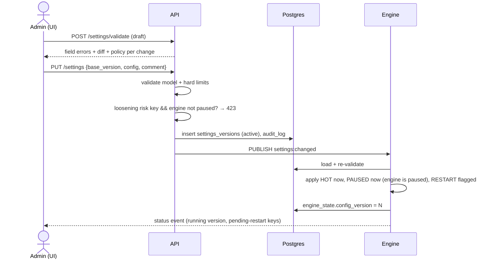

# 06 — Configuration Model

## 1. Three layers

| Layer | Where | Who edits | Contents |
|---|---|---|---|
| **Hard limits** | Code constants in `intraday/core/hard_limits.py` (in `core` so both config validation and the risk engine can import them) | Code change + review only | Absolute bounds no setting can exceed (§5) |
| **Environment** | `.env` on the VM (mode 600), per-container `env_file` | Operator, requires restart | Secrets, safety switches, infrastructure (§2) |
| **Runtime settings** | `settings_versions` table, seeded from `config/defaults.yaml` | Settings UI (audited, versioned) | Everything in SPEC §4 and more (§3) |

Load order on boot: `defaults.yaml` → the latest active DB version (if any) → validate against the Pydantic model and hard limits. If validation fails, the engine refuses to trade (`CONFIG_ERROR`) and the API shows the errors.

## 2. Environment variables (`.env.example`)

| Variable | Container | Example / default | Notes |
|---|---|---|---|
| `TRADING_MODE` | engine, api | `PAPER` | Engine refuses to trade unless exactly `PAPER`. The API shows it on the banner. |
| `ALPACA_BASE_URL` | engine | `https://paper-api.alpaca.markets` | Must equal the paper endpoint after normalisation, or the engine refuses. |
| `ALPACA_API_KEY_ID` | engine | `PK_PLACEHOLDER` | Paper key |
| `ALPACA_API_SECRET_KEY` | engine | `CHANGE_ME` | |
| `ALPACA_DATA_FEED_DEFAULT` | engine | `iex` | Seed for the `data.feed` setting |
| `ANTHROPIC_API_KEY` | engine | *(empty)* | Optional. If empty, `AI_MODE` is forced to `OFF` and the UI explains why. |
| `DATABASE_URL` | api, engine | `postgresql+asyncpg://intraday:…@postgres:5432/intraday` | Separate DB roles for api and engine (§6) |
| `REDIS_URL` | api, engine | `redis://redis:6379/0` | |
| `POSTGRES_PASSWORD` etc. | postgres | | |
| `SESSION_SECRET` | api | 64 random bytes | Used to sign CSRF tokens |
| `PUBLIC_ORIGIN` | api, caddy | `https://trade.example.com` | CORS/Origin checks, Caddy site |
| `SMTP_HOST/PORT/USER/PASSWORD/FROM`, `ALERT_EMAIL_TO` | engine | | Email notifier |
| `LOG_LEVEL` | all | `INFO` | |
| `TZ` | all | `UTC` | The app converts to ET explicitly. The host stays on UTC. |

There's no `LIVE_TRADING_ENABLED` in V1. SPEC §49 lists it as a *future* requirement, and adding it would suggest a switch that doesn't exist.

## 3. Runtime settings (defaults)

Apply policies: **HOT** means it takes effect on the next decision cycle. **PAUSED** means loosening is refused unless the engine is paused (tightening is always HOT). **RESTART** means it takes effect on the engine's next start or session open.

### 3.1 Capital and risk (SPEC §4, CLAUDE.md defaults)

| Key | Default | Bounds (UI) | Policy |
|---|---|---|---|
| `risk.paper_initial_balance` | 100000 | 1,000 – 10,000,000 | HOT (backtest/replay only; C8) |
| `risk.max_capital_per_trade` | 10000 | 100 – hard cap | PAUSED |
| `risk.max_total_exposure` | 50000 | ≥ per-trade, ≤ hard cap | PAUSED |
| `risk.max_open_positions` | 5 | 1 – 20 | PAUSED |
| `risk.max_daily_loss` | 500 | 10 – hard cap | PAUSED |
| `risk.max_loss_per_trade` | 100 | 1 – min(daily loss, hard cap) | PAUSED |
| `risk.max_daily_trades` | 20 | 1 – 100 | PAUSED |
| `risk.max_trades_per_symbol_per_day` | 3 | 1 – 10 | PAUSED |
| `risk.max_sector_exposure` | 20000 | ≤ total exposure | PAUSED |
| `risk.max_correlated_exposure` | 20000 | ≤ total exposure | PAUSED |
| `risk.correlation_threshold` | 0.70 | 0.3 – 0.95 | PAUSED |
| `risk.correlation_lookback_days` | 20 | 5 – 60 | HOT |
| `risk.min_risk_reward` | 1.5 | 1.0 – 5.0 | PAUSED |
| `risk.buying_power_utilization` | 0.90 | 0.1 – 1.0 | PAUSED |
| `risk.slippage_buffer_bps` | 5 | 0 – 50 | PAUSED (added to risk/share when sizing) |
| `risk.min_position_value` | 500 | 0 – per-trade | HOT |
| `risk.reentry_cooldown_minutes` | 15 | 0 – 240 | PAUSED (same symbol after exit) |
| `risk.daily_loss_action` | `KEEP_STOPS` | `KEEP_STOPS \| FLATTEN` | HOT |
| `risk.emergency_stop_action` | `CLOSE_ALL` | `CLOSE_ALL \| KEEP_STOPS` | HOT |
| `risk.daily_loss_basis` | `WORST_CASE_OPEN_RISK` | `WORST_CASE_OPEN_RISK \| CURRENT_PNL` | PAUSED (07 §4) |
| `risk.allow_short_selling` | `false` | **locked** | — |
| `risk.allow_fractional_shares` | `false` | **locked** (C1) | — |

### 3.2 Exits (SPEC §14)

| Key | Default | Bounds | Policy |
|---|---|---|---|
| `exits.default_stop_loss_percent` | 1.0 | 0.2 – 5.0 | PAUSED |
| `exits.default_take_profit_percent` | 2.0 | 0.2 – 20 | HOT |
| `exits.trailing.enabled` | true | | HOT |
| `exits.trailing.activation_r` | 1.0 | 0.25 – 5 | HOT (activate after +1R) |
| `exits.trailing.distance_percent` | 0.75 | 0.2 – 5 | HOT (never widens a stop) |
| `exits.max_holding_minutes` | 90 | 5 – 390 | HOT |
| `exits.momentum_reversal.enabled` | true | | HOT |
| `exits.vwap_loss.enabled` | true | | HOT (close below VWAP for N bars) |
| `exits.vwap_loss.bars` | 2 | 1 – 10 | HOT |
| `exits.regime_reversal.enabled` | true | | HOT |

### 3.3 Trading hours (SPEC §36, ET)

| Key | Default | Policy |
|---|---|---|
| `hours.trading_start` | 09:35 | HOT |
| `hours.no_new_trades_after` | 15:30 | HOT |
| `hours.force_close` | 15:55 | PAUSED (later = looser) |
| `hours.trading_end` | 16:00 | HOT (monitoring end) |
| `hours.early_close_no_new_trades_offset_min` | 30 | HOT (G1: before actual close) |
| `hours.early_close_force_close_offset_min` | 5 | PAUSED |

Validation: start < no_new_trades < force_close < trading_end ≤ market close.

### 3.4 Universe (SPEC §7)

| Key | Default | Notes |
|---|---|---|
| `universe.min_stock_price` | 10 | Hard floor 5 |
| `universe.min_average_daily_volume` | 20000 | **Units of the configured feed** (IEX ≈ 2–3% of consolidated). Calibrate in Phase 3. See the flagged item in README. |
| `universe.adv_lookback_days` | 20 | |
| `universe.min_market_cap` | 2,000,000,000 | Applied only when the watchlist entry has `market_cap`. Blank means the filter is skipped and noted in the scan reasons. |
| `universe.max_spread_percent_iex` / `_sip` | 0.30 / 0.10 | Feed-specific (G2); two flat keys so the settings form stays schema-driven |
| `universe.min_bar_coverage` | 0.80 | Fraction of last 30 minutes with a bar |
| `universe.max_watchlist_size` | 20 | Stream budget; see README flagged item 1 |
| `universe.scan_interval_minutes` | 5 | Scan cadence during the session (also 09:25 ET and on demand) *(Phase 3)* |

### 3.5 Strategies (SPEC §12), each with `enabled`, `weight_overrides?`, `stop_method`, `stop_percent?`, `take_profit_percent?`

| Strategy | Key parameters (defaults) |
|---|---|
| `momentum_breakout` | `breakout_lookback_bars: 15`, `min_rvol: 1.5`, `min_volume_increase_bars: 3`, `require_above_vwap: true`, `require_ema9_gt_ema20: true` |
| `vwap_reclaim` | `min_bars_below_vwap: 5`, `reclaim_confirm_bars: 1`, `min_rvol: 1.2`, `require_rsi_above: 50` |
| `pullback` | `trend_min_bars: 20`, `max_pullback_percent: 1.5`, `support: EMA20\|VWAP`, `support_tolerance_percent: 0.2`, `min_rvol: 1.0` |

`stop_method` is `PERCENT` (default), `ATR` (`atr_multiple: 1.5`), or `STRUCTURE` (below VWAP/swing low, capped by `max_stop_percent`). The risk engine enforces the result regardless of method.

### 3.6 Scoring and regime (SPEC §13, §33)

| Key | Default |
|---|---|
| `scoring.weight_*` (one key per factor) | momentum 0.20, volume 0.20, price_action 0.20, market_regime 0.15, volatility 0.10, technical 0.10, news 0.05 (must sum to 1.00 ± 0.001) |
| `scoring.min_trade_score` | 0.70 (inherits SPEC's `MIN_AI_CONFIDENCE` value; D2) |
| `regime.unknown_policy` | `DISABLE` (`DISABLE \| REDUCE`) |
| `regime.bearish_policy` | `DISABLE` (long-only) |
| `regime.high_volatility_size_multiplier` | 0.5 |
| `regime.reduce_size_multiplier` | 0.5 |

### 3.7 AI (CLAUDE.md §AI)

| Key | Default | Notes |
|---|---|---|
| `ai.mode` | `OFF` | `OFF \| EXPLAIN \| VETO`. Changing to VETO is PAUSED policy. |
| `ai.provider` | `anthropic` | `anthropic` only in V1; others are stubs. |
| `ai.model` | *(empty)* | Required when mode ≠ OFF. Never hardcoded; the UI suggests current model IDs. |
| `ai.effort` | `low` | Veto/explain are short classification-like calls |
| `ai.timeout_seconds` | 10 | |
| `ai.max_consecutive_failures` | 3 | → `AI_UNAVAILABLE` block (VETO only) |
| `ai.news_sentiment_enabled` | true | Only effective in VETO mode (G4) |

### 3.8 Market data, news, execution, alerts

| Key | Default |
|---|---|
| `data.feed` | `iex` (RESTART) |
| `data.stale_seconds` | 120 |
| `data.bar_interval` | `1Min` (**locked**, CLAUDE.md) |
| `news.enabled` | true |
| `news.lookback_hours` | 24 |
| `news.block_event_tags` | `[earnings, fda, merger_acquisition, trading_halt]` → symbol skipped for the session |
| `execution.entry_limit_offset_bps` | 5 |
| `execution.entry_timeout_seconds` | 30 |
| `execution.exit_fill_timeout_seconds` | 20 |
| `execution.reconcile_interval_seconds` | 30 |
| `alerts.email_enabled` | true |
| `alerts.email_min_severity` | `HIGH` |

### 3.9 Removed or renamed from SPEC §4

| SPEC key | Status |
|---|---|
| `MAX_CONCURRENT_POSITIONS` | Merged into `risk.max_open_positions` (C7) |
| `MIN_AI_CONFIDENCE` | Replaced by `scoring.min_trade_score` (D2) |
| `ALLOW_FRACTIONAL_SHARES` | Locked false (C1) |
| `ALLOW_SHORT_SELLING` | Locked false |
| SPEC §7 "exclude ETFs / leveraged ETFs unless explicitly enabled" | **Removed.** No toggle exists; only U.S. common stock on NYSE/Nasdaq is tradable (CLAUDE.md "Tradable assets", 07 §2a). |
| `AI_MODEL` | `ai.model` |

## 4. Change workflow

"Loosening" is defined per key: a higher cap, a later cutoff, a wider stop bound, a lower min score, or a lower min R/R. The comparator lives next to each field definition, so it's unit-tested.

## 5. Hard limits (code, not UI)

| Limit | Value | Rationale |
|---|---|---|
| Min stock price floor | $5 | No penny stocks regardless of settings |
| Max loss per trade | ≤ 1% of equity | Capital preservation |
| Max daily loss | ≤ 3% of equity | |
| Max total exposure | ≤ 1.0 × equity | No margin use |
| Max capital per trade | ≤ 25% of equity | |
| Max open positions | ≤ 20 | |
| Stop loss | Always required; 0.2%–5% from entry | Spec §2 |
| Force-close | ≥ 2 min before actual close | Room for retries |
| Tradable asset type | U.S.-issuer common stock on NYSE/Nasdaq only (07 §2a) | CLAUDE.md "Tradable assets" |
| Short selling, fractional, live endpoint | Impossible | |

## 6. Secrets handling

- `.env` is `chmod 600`, owned by the deploy user and never committed. `.gitignore` covers `.env*` except `.env.example`, and a CI check fails if a key pattern (`PK…`, `sk-ant-…`) appears in the repo.
- The engine receives Alpaca and Anthropic keys. The API receives neither.
- DB roles: `intraday_api` gets SELECT on everything, INSERT/UPDATE on settings/users/sessions/audit/commands/backtests/alerts ack/watchlist, and no writes to orders/positions/fills. `intraday_engine` gets full DML on trading tables and INSERT only on audit tables.
- Spec §28's "encrypted credentials" is met this way: no credentials are stored in the DB, off-site backups are age-encrypted, and the VM disk is encrypted at the provider level. SOPS or age-encrypted `.env` is optional.
