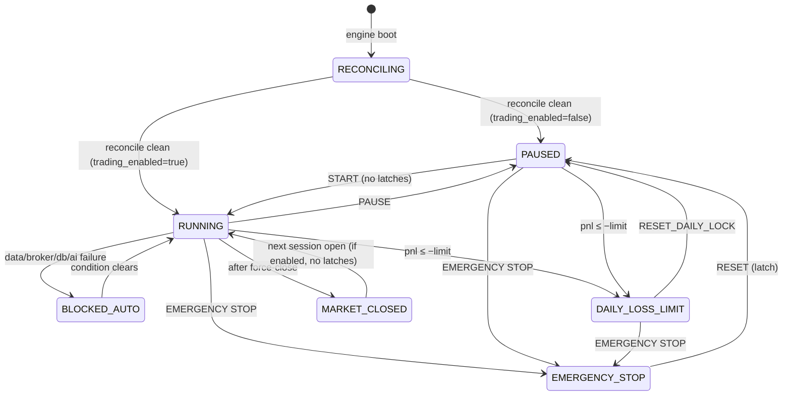

# 07 — Risk-Engine Design

## 1. Role

The risk engine is the **final authority** on every entry (SPEC §2). It is a pure, synchronous, deterministic function:

```python
def evaluate(
    proposal: TradeProposal,          # from scorer (+ optional LLM approval)
    portfolio: PortfolioSnapshot,     # positions + pending entry orders + today's P&L
    account: AccountSnapshot,         # equity, cash, buying power (broker truth)
    market: SymbolMarketSnapshot,     # last price, quote, spread, data-quality flags, sector
    gate: GateSnapshot,               # active blocks from EngineState
    config: RiskConfig,               # validated settings + hard limits
    clock: SessionClock,              # ET now, session cutoffs incl. early close
) -> RiskDecision
```

- No I/O, no randomness, no wall-clock reads. The same inputs give the same output, which makes it testable and replayable.
- It runs **every** check and records each result (`risk_evaluations.checks`) even after one fails, so the audit shows everything that was wrong.
- An exception inside `evaluate` counts as a reject. The engine latches `RISK_ENGINE_ERROR` (fail closed).
- The same function is used live, in replay and in backtests.

Exits don't need risk approval; reducing risk is always allowed. The order manager still enforces the invariants in §7.

## 2. Check catalogue

| # | Check | Rule (reject if violated) | SPEC |
|---|---|---|---|
| R1 | Trading gate | `gate.blocks` is empty (paused, emergency, daily loss, data/broker/DB/AI down, reconciling, mismatch) | §2, §27 |
| R2 | Paper mode | `TRADING_MODE == PAPER` and broker is paper (checked at boot, re-asserted here as a cheap invariant) | §3 |
| R3 | Trading hours | `trading_start ≤ now < no_new_trades_after` (early-close adjusted), market open per calendar | §36 |
| R4 | Long only | `proposal.side == BUY` and no existing position in symbol | CLAUDE.md |
| R5 | Min price | `last_price ≥ max(min_stock_price, HARD_MIN_PRICE)` | §7 |
| R6 | Data quality | Symbol bars fresh, coverage ≥ min, no halt flag, no suspicious-data flag, quote not crossed | §2, §7 |
| R7 | Spread | `spread_pct ≤ max_spread_percent[feed]` | §7, §34 |
| R8 | Stop-loss present | Stop exists, `stop < entry`, distance within [0.2%, max(config, hard 5%)] | §2 |
| R9 | Take-profit present | Target exists, `target > entry` | §2 |
| R10 | Risk/reward | `(target − entry) / (entry − stop) ≥ min_risk_reward` | §34 |
| R11 | Daily trade count | `trades_today < max_daily_trades` (counts submitted entries, incl. pending) | §4 |
| R12 | Per-symbol count | `symbol_trades_today < max_trades_per_symbol_per_day` | §4 |
| R13 | Re-entry cooldown | `now − last_exit(symbol) ≥ reentry_cooldown` | §1.11 |
| R14 | Open positions | `open + pending_entries < max_open_positions` | §4 |
| R15 | Sized qty ≥ 1 | After §3 sizing, qty ≥ 1 and value ≥ `min_position_value` | §5 |
| R16 | Total exposure | `exposure + pending + qty×entry ≤ max_total_exposure` (guaranteed by sizing, re-verified) | §4 |
| R17 | Max loss per trade | `qty × (entry − stop + slippage_buffer) ≤ max_loss_per_trade` | §5 |
| R18 | Daily loss (worst case) | See §4 | §5, §6 |
| R19 | Buying power | `qty×entry ≤ buying_power × utilization` (broker truth) | §2 |
| R20 | Sector exposure | `sector_exposure + qty×entry ≤ max_sector_exposure` | §35 |
| R21 | Correlated exposure | Sum over cluster (§5) `+ qty×entry ≤ max_correlated_exposure` | §35 |
| R22 | Regime | Regime policy allows entries (UNKNOWN/BEARISH → DISABLE by default); multiplier applied in sizing | §33 |
| R23 | News events | Symbol not tagged with a blocked event today | §11 |
| R24 | Duplicate intent | No non-terminal entry order for the symbol | §16 |
| R25 | LLM veto consistency | In VETO mode, `proposal.llm_verdict == APPROVE`. The LLM can only remove trades, never add them. | CLAUDE.md |
| R26 | Asset eligibility | `is_eligible_common_stock(symbol_meta, alpaca_asset)` returns true (§2a). Re-evaluated here from the DB and Alpaca asset cache, **independently** of the universe filter's earlier result. | CLAUDE.md "Tradable assets" |

### 2a. Asset eligibility (CLAUDE.md "Tradable assets")

V1 trades **U.S.-issuer common stock listed on NYSE or Nasdaq, long only**. Nothing else is tradable, and no setting changes that. The rule is one pure function, `core/assets.py::is_eligible_common_stock`, and the universe filter, the risk engine (R26), the order manager (§7) and the database (04 CHECK constraint) all apply it independently. A symbol is eligible only if **every** rule passes:

| # | Rule | Source |
|---|---|---|
| E1 | `role == TRADABLE`. SPY, QQQ, sector ETFs and the volatility proxy are `CONTEXT` and never tradable. | Watchlist (hand-entered) |
| E2 | `asset_type == COMMON_STOCK` | Watchlist (hand-entered, D3) |
| E3 | `country == "US"` (U.S. issuer; excludes ADRs and foreign ordinary shares, D5) | Watchlist (hand-entered) |
| E4 | Alpaca `class == us_equity`, `exchange ∈ {NYSE, NASDAQ}`. This rejects ARCA, AMEX, BATS and OTC. | Alpaca asset cache (synced daily + at add time) |
| E5 | Alpaca `status == active` and `tradable == true` | Alpaca asset cache |
| E6 | Symbol matches `^[A-Z]{1,5}(\.[A-B])?$`, which allows share classes like `BRK.B` and rejects preferred, warrant, unit and rights suffixes | Symbol |
| E7 | Name heuristic finds no disqualifying term: `ETF`, `ETN`, `Fund`, `Index`, `Warrant`, `Right`, `Unit`, `Preferred`, `Pfd`, `Depositary`, `ADR`, `ADS`, `Notes`, `Debenture`, `Bond`, `Leveraged`, `Inverse`, `2x`/`3x` | Alpaca asset name |

- A heuristic failure (E6/E7) while the hand-entered data says `COMMON_STOCK`/`US` makes the symbol **ineligible**, with a WARN asking the owner to review. Heuristics can only reject, never admit.
- If the Alpaca asset cache is missing or older than 7 days, the symbol is ineligible (fail closed).
- Options, crypto, futures, forex and bonds can't reach this function at all. The broker adapter only calls the U.S.-equity order endpoint, and the order model has no asset-class field that could name another class.

## 3. Position sizing

All arithmetic uses `Decimal`, and share counts are floored.

```
entry          = proposal.entry_ref_price         (ask-based; limit price for the order)
risk_per_share = (entry − stop) + entry × slippage_buffer_bps / 10_000
multiplier     = regime multiplier (1.0 | 0.5)

qty_risk       = floor(max_loss_per_trade × multiplier / risk_per_share)
qty_capital    = floor(max_capital_per_trade × multiplier / entry)
qty_exposure   = floor((max_total_exposure − exposure − pending_exposure) / entry)
qty_bp         = floor(buying_power × bp_utilization / entry)
qty_daily      = floor(daily_loss_headroom / risk_per_share)         (§4)
qty_sector     = floor((max_sector_exposure − sector_exposure) / entry)
qty_corr       = floor((max_correlated_exposure − cluster_exposure) / entry)

qty            = max(0, min(all of the above))
```

Each bound is stored in `risk_evaluations.sizing`, so the UI can show which constraint was binding.

**Unit-test case (SPEC §5, not a default):** account $100,000; max per trade $2,000; max loss $100; stock $50; stop 1%; slippage buffer 0.
risk/share $0.50 → `qty_risk` 200; `qty_capital` 40 → **qty 40**, value $2,000, max stop loss $20.

**Default-config case:** max per trade $10,000; same stock → `qty_risk` 200, `qty_capital` 200 → qty 200, value $10,000, max loss $100. With the 5 bps buffer, risk/share is $0.525 → `qty_risk` 190, so qty is 190 and max loss is $99.75 including the buffer.

## 4. Daily loss

**Measured P&L:** `daily_pnl = realized_net_today + unrealized_mark_to_market`, computed from fills and last trade prices. The broker account's `equity − last_equity` is cross-checked, and a divergence above $5 raises a WARN.

**Limit trigger:** the P&L monitor runs every 5 s and on every fill. When `daily_pnl ≤ −max_daily_loss`:

1. Latch `DAILY_LOSS_LIMIT` and set status `DAILY_LOSS_LIMIT_REACHED`.
2. Cancel all pending entry orders.
3. `daily_loss_action`: `KEEP_STOPS` (default) leaves brackets and engine exits running. `FLATTEN` closes all positions.
4. Write `risk_events` and raise a HIGH alert (dashboard + email).
5. The latch stays until `RESET_DAILY_LOCK`. It persists across sessions (README flagged item 3).

**Pre-trade check R18, `WORST_CASE_OPEN_RISK` (default):**
```
loss_used          = max(0, −daily_pnl)
open_risk          = Σ over open positions: max(0, qty × (mark − current_stop))
                     + Σ pending entries: qty × risk_per_share
daily_loss_headroom = max_daily_loss − loss_used − open_risk
require: qty × risk_per_share ≤ daily_loss_headroom
```
Even if every open stop is hit at once, the day can't exceed the limit, apart from gaps and slippage beyond the buffer. With the defaults (5 × $100 = $500) this allows exactly five full-risk positions. Once a trailing stop moves a position to breakeven, its open risk drops to zero and frees headroom. The `CURRENT_PNL` mode only checks `loss_used + new trade risk ≤ limit`, which is looser.

## 5. Correlation control (SPEC §35)

- **Sector:** exposure grouped by the watchlist's `sector` (D3).
- **Correlation clusters:** Pearson correlation of 5-minute log returns over `correlation_lookback_days`, computed nightly and cached. For a candidate *c*, `cluster(c)` is the set of held symbols with correlation ≥ `correlation_threshold`, plus *c*. Cluster exposure is the notional sum over that set.
- If a symbol has fewer than 60% of the lookback bars, it's treated as correlated with its sector ETF's cluster, which is the conservative choice.

## 6. Trading gate and system status

The gate is a set of **block reasons**. New entries are allowed only when the set is empty. The status shown in the UI is the highest-priority active reason.

| Reason | Set by | Clears | Display status |
|---|---|---|---|
| `EMERGENCY_STOP` | User | Manual (latched) | EMERGENCY STOP |
| `DAILY_LOSS_LIMIT` | P&L monitor | Manual (latched) | DAILY LOSS LIMIT |
| `RISK_ENGINE_ERROR` | Exception | Manual (latched) | BROKER ERROR* |
| `RECONCILE_MISMATCH` | Reconciler | Manual, or auto if self-explained | BROKER ERROR |
| `RECONCILING` | Boot / broker reconnect | First clean reconcile | BROKER ERROR |
| `BROKER_DOWN` | Broker health | Auto | BROKER ERROR |
| `DB_DOWN` | DB health | Auto (after spool flush) | DATA ERROR |
| `DATA_STALE` | Market data | Auto | DATA ERROR |
| `AI_UNAVAILABLE` | AI health (VETO only) | Auto | DATA ERROR* |
| `CONFIG_ERROR` | Settings validation / paper guard | Fix config + restart | EMERGENCY STOP* |
| `NO_BROKER` | Engine boot without a broker (keys missing or broker build failed; replaced `ENGINE_INCOMPLETE` in Phase 8) | Cleared when the broker is built | BROKER ERROR |
| `PAUSED_BY_USER` | User | START | PAUSED |
| `OUTSIDE_ENTRY_WINDOW` | Clock | Clock | MARKET CLOSED / RUNNING (exits only) |
| `REGIME_BLOCKED` | Regime policy | Auto | RUNNING (with note) |

\*SPEC §20's status list is fixed. For reasons without a natural label, the UI shows the listed status plus the specific reason text.



After any reset the engine lands in **PAUSED**. Trading resumes only after an explicit START.

## 7. Invariants enforced below the risk engine (order manager)

Defence in depth, independent of the risk engine:

- Refuse any `buy` for a symbol that fails `is_eligible_common_stock` (§2a), re-evaluated at submit time. This is the third independent asset check, after the universe filter and R26.
- Refuse any `buy` without attached stop-loss and take-profit legs.
- Refuse any `sell` whose qty exceeds the broker-reported position qty (prevents accidental shorts). In addition, Alpaca account configuration `no_shorting=true` is set at startup and verified in Phase 7.
- Re-check the gate immediately before submitting.
- Refuse submission if `client_order_id` already exists in `orders` (08 §4).

## 7a. As built (Phase 5)

- Limits R16–R21 are enforced by **sizing** (the quantity shrinks to fit); the checks
  re-verify afterwards. A limit with no room left gives qty 0 and fails R15.
- The hard limits are re-applied at every evaluation from current equity
  (`risk/limits.py::effective_limits`): 1% loss per trade, 3% daily loss, 1.0× exposure,
  and 25% capital per trade.
- Until the broker exists (Phase 7), account figures come from
  `risk.paper_initial_balance` (source `DERIVED`, shown on every evaluation).
- A proposal's `decision_result` is `BLOCKED` when only R1 (the gate) failed, and
  `RISK_REJECTED` otherwise, with the failed IDs in `ai_decisions.block_reasons`.

## 8. Tests (Phase 5)

- Table tests for each check R1–R26 (pass and fail), plus one test per eligibility rule E1–E7 with real-world examples (SPY, TQQQ, BRK.B, BAC preferred, a warrant, TSM ADR, SHOP, an OTC name).
- The SPEC §5 example and default-config case exactly as in §3.
- Hypothesis property tests: for any inputs, `approved ⇒ qty×risk_per_share ≤ max_loss_per_trade`, `exposure_after ≤ max_total_exposure`, `open_after ≤ max_open_positions`, `worst-case daily loss ≤ max_daily_loss`, and `qty` is an integer ≥ 1.
- An exception injected in a check leads to reject plus the `RISK_ENGINE_ERROR` latch.
- Daily loss: trigger, cancel entries, KEEP_STOPS vs FLATTEN, latch persists across a session boundary, reset lands in PAUSED.
