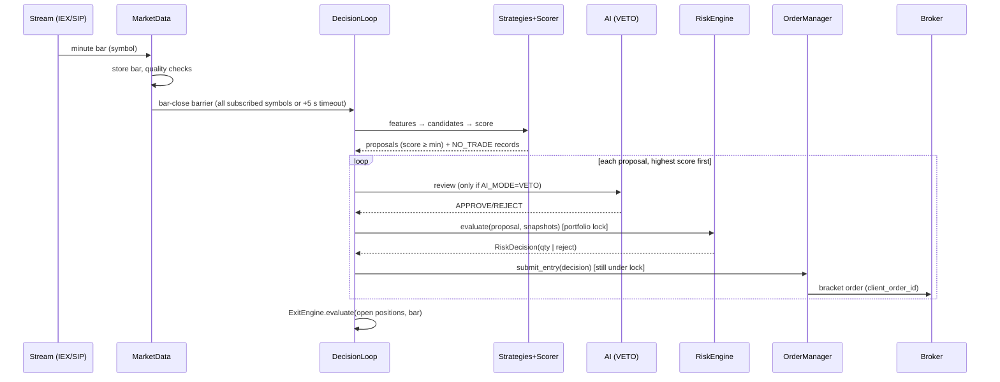
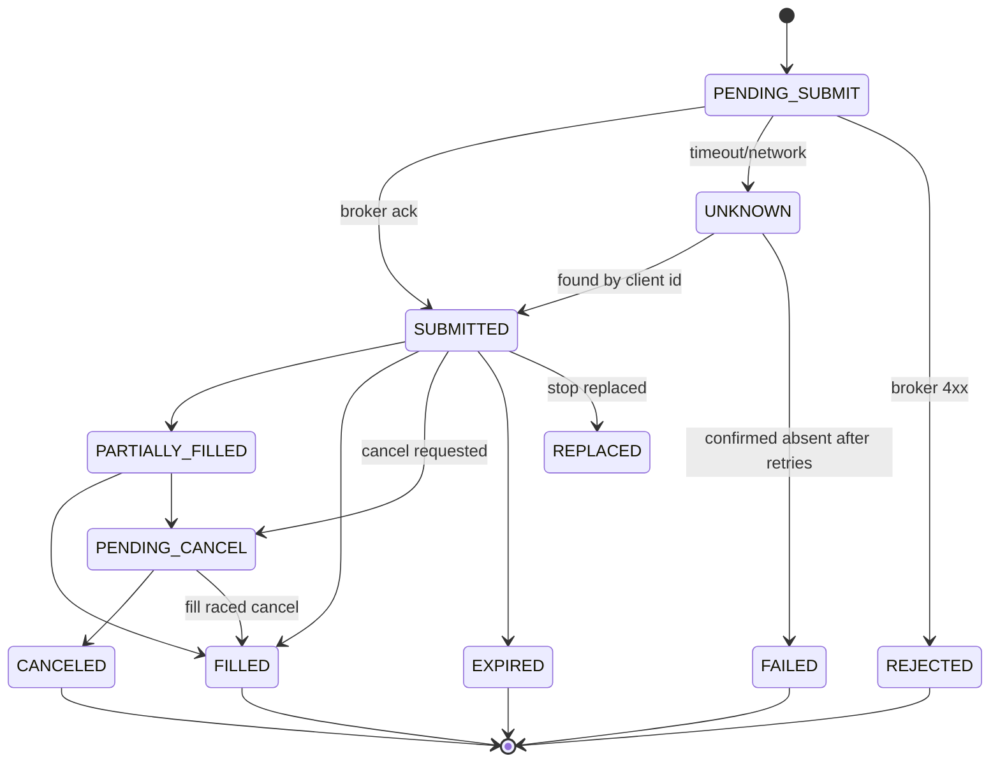
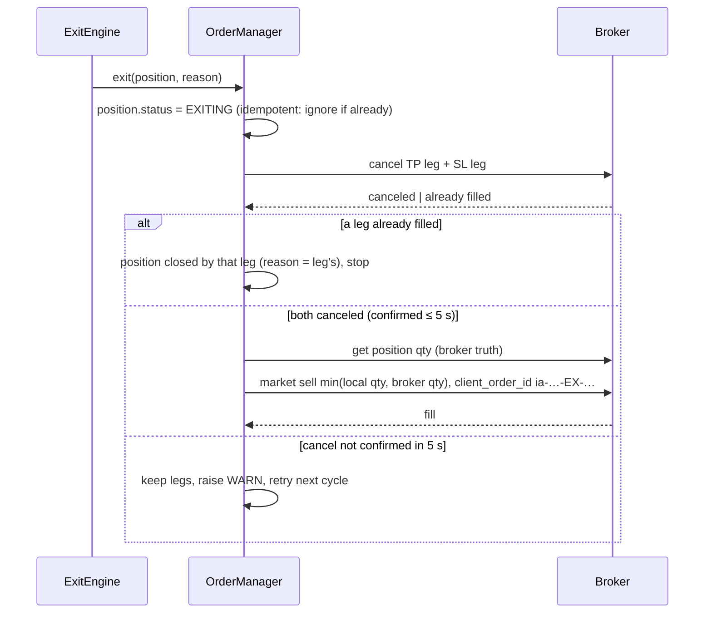

# 08 — Trading-Engine Design

## 1. Components

| Component | File | Responsibility |
|---|---|---|
| `Broker` (interface) | `trading/broker/base.py` | `get_account`, `get_positions`, `get_orders`, `get_order_by_client_id`, `submit_bracket_entry`, `submit_market_exit`, `cancel_order`, `replace_stop`, `close_all`, `stream_trade_updates`, `get_clock`, `get_calendar`, `configure_account` |
| `AlpacaPaperBroker` | `trading/broker/alpaca_paper.py` | alpaca-py implementation; paper guard in constructor |
| `SimBroker` | `trading/broker/sim.py` | Deterministic fill simulator for backtest/replay (§9) |
| `FutureLiveBroker` | `trading/broker/future_live.py` | Every method raises `NotImplementedError` (CLAUDE.md) |
| `OrderManager` | `trading/order_manager.py` | Idempotent submission, order state machine, retries, stale-order handling |
| `PositionManager` | `trading/position_manager.py` | Local position state, marks, P&L, stop/target tracking |
| `ExitEngine` | `trading/exits.py` | Evaluates exit rules; issues exit intents |
| `Reconciler` | `trading/reconciler.py` | Compares local vs broker state; raises mismatches |
| `Liquidator` | `trading/liquidation.py` | Force-close, emergency, flatten, with verification and escalation |
| `EngineRuntime` | `engine/runtime.py` | Wires tasks, owns `EngineState` (gate), supervisor, scheduler |

## 2. Paper guard (two independent checks)

1. **Engine boot** (`core/safety.py`): `TRADING_MODE == "PAPER"` and `normalize(ALPACA_BASE_URL) == "https://paper-api.alpaca.markets"`. If either fails, the engine enters `CONFIG_ERROR`, never constructs a broker, stays alive so the UI can show why, and logs CRITICAL.
2. **Broker factory** (`trading/broker/factory.py`): repeats the same checks, then constructs `TradingClient(paper=True, url_override=None)`. After connecting it checks that the account number has the paper prefix (Alpaca paper accounts start with `PA`, verified in Phase 7) and refuses if not.
3. Startup account configuration: `no_shorting=true`, fractional off where the API allows it. Read back and verified.

There is no code path that constructs a non-paper client. `FutureLiveBroker` exists only as an interface stub.

## 3. Runtime loop

- Proposals are processed sequentially under the portfolio lock, so the second proposal in a bar is sized against exposure that includes the first one as pending.
- The DecisionLoop has a 20 s budget per bar. If it overruns, the remaining proposals are dropped with `decision_result=BLOCKED` and reason `CYCLE_TIMEOUT`.

## 4. Idempotency and client_order_id

Format: `ia-{yyyymmdd}-{intent}-{decision_or_position_short_id}-{attempt}`, for example `ia-20260921-EN-7f3a9c21-0`. It is 128 characters or fewer and unique per logical order.

Submission protocol:

1. **Persist intent first:** insert the `orders` row with status `PENDING_SUBMIT` and its `client_order_id` in its own transaction.
2. Submit to broker.
3. On success, store `broker_order_id` and set `SUBMITTED`.
4. On timeout or network error, **don't resubmit blindly.** Query `get_order_by_client_id`:
   - Found → adopt it; this is the success path.
   - Not found → retry with the **same** client_order_id (Alpaca rejects duplicates, so a double-submit is impossible), up to 3 attempts with backoff (0.5 s, 1 s, 2 s).
   - Still unknown → mark `UNKNOWN`, block new entries (`BROKER_DOWN`), and let the reconciler settle it.
5. On restart, every `PENDING_SUBMIT`/`UNKNOWN` row is resolved via lookup by client_order_id before any new trade is allowed.

## 5. Order state machine (local)

Broker trade-update stream events drive the transitions. A 10 s REST poll of non-terminal orders covers stream gaps. Every transition writes an `order_events` row.

## 6. Entry execution

1. `limit = min(ask × (1 + entry_limit_offset_bps/10⁴), proposal max entry)`, rounded to tick. If the quote is stale, the IEX ask is missing or spread R7 fails, the entry is skipped.
2. Stop and target prices are recomputed from the **limit** price, so the risk check matched what's actually submitted. The risk engine sized with this same price.
3. Submit a bracket order: `side=buy, type=limit, tif=day, order_class=bracket, take_profit.limit_price, stop_loss.stop_price`.
4. **Entry timeout** (`entry_timeout_seconds`, 30 s): cancel the unfilled remainder.
   - Zero filled → the position becomes `ABANDONED`, and the decision is kept for audit.
   - Partial fill → position qty = filled qty. Leg quantities are verified against the filled qty; if they don't match, the legs are replaced. Fallback: cancel the legs and submit an OCO exit for the filled qty. Which behaviour Alpaca uses is verified against paper in Phase 7.
5. On fill: position becomes `OPEN`, `initial_stop`/`stop_price`/`take_profit_price` are set from the actual legs, and `risk_amount` is recomputed from the actual avg entry.

## 7. Exit engine (SPEC §14)

Exit checks run on every bar close (bar-based rules) and in the PositionMonitor every 5 s (price-based rules using latest trade/quote). The **broker bracket is always the safety net** for stop and target. The engine only exits earlier or tightens.

| # | Exit | Rule (defaults) | Executed by |
|---|---|---|---|
| 1 | Stop loss | Price ≤ stop | Broker stop leg |
| 2 | Take profit | Price ≥ target | Broker TP leg |
| 3 | Trailing stop | After +`activation_r`·R, stop = max(stop, high_water × (1 − distance%)); **only ever raised** | Engine: `replace_stop` on the leg (fallback: cancel legs + new OCO) |
| 4 | Time exit | Holding > `max_holding_minutes` | Engine market exit |
| 5 | Momentum reversal | EMA9 crosses below EMA20 **and** MACD histogram < 0 on bar close | Engine market exit |
| 6 | VWAP loss | `vwap_loss.bars` consecutive closes below VWAP | Engine market exit |
| 7 | Regime reversal | Regime switches to BEARISH or HIGH_VOLATILITY with falling SPY | Engine market exit |
| 8 | EOD liquidation | At `force_close` | Liquidator (§8) |

**Engine exit procedure** (early exit while the bracket is live):

The position is never left without broker-side protection. If the exit sell isn't filled within `exit_fill_timeout_seconds`, the engine retries and raises a HIGH alert. It then re-places a protective stop, so a stuck exit can't leave the position unprotected.

## 8. End-of-day liquidation (SPEC §15) and emergency paths

Scheduled with APScheduler using that day's calendar, including early closes (G1):

| Time (ET, normal day) | Action |
|---|---|
| 09:25 | Session prep: load calendar, reset daily counters (latches persist), refresh universe scan, warm features from prior bars |
| 09:35 | Entry window opens (if RUNNING) |
| 15:30 | Entry window closes. Cancel unfilled entry orders. |
| 15:55 | **Force close.** Block entries, cancel all open orders, then market-sell every position the **broker** reports (not only the ones known locally). |
| 15:55–15:58 | Verify flat every 10 s and retry failures. |
| 15:58 | Not flat → **HIGH alert** (dashboard + email), retry every 15 s. |
| 15:59:30 | Still not flat → **CRITICAL alert** |
| 16:00 | Stop monitoring. Finalize `daily_pnl`. Status MARKET_CLOSED. |
| 16:15 | Final reconcile. Positions still at the broker produce a CRITICAL "overnight position" alert. |

**Emergency stop:** latch → cancel all entry orders → if `CLOSE_ALL` (default), cancel all orders and liquidate everything with the same verify/escalate loop; otherwise keep brackets.
**Daily-loss FLATTEN** and **Close All** use the same Liquidator.

## 9. Reconciliation (SPEC §17, §27)

Runs at boot (blocking: status RECONCILING), every `reconcile_interval_seconds` (30 s), after any broker/WS reconnect, and on demand.

1. Fetch the broker's positions, open orders, and orders closed since the last reconcile.
2. Skip symbols with orders in flight for less than 5 s, to avoid racing the stream.
3. Compare:

| Case | Resolution |
|---|---|
| Order status differs | Adopt broker status; write `order_events(source=RECONCILE)`; apply fills |
| Local OPEN, broker flat, and a closing fill is found in broker orders | Close locally with that fill, exit reason from leg type. **Self-explained, no block.** |
| Local OPEN, broker flat, no explaining fill | `RECONCILE_MISMATCH` latch + HIGH alert |
| Qty differs | Broker is truth for qty. Latch + alert. |
| Broker position unknown locally | `UNEXPECTED_POSITION` latch + HIGH alert. The position is included in force-close. The UI offers "Close" (the engine does not auto-adopt it). |
| Local `PENDING_SUBMIT`/`UNKNOWN` | Resolve by client_order_id (§4) |
| Position has no live protective stop at broker | Immediately re-place a stop at `stop_price` (OCO with target) + WARN |

4. Write a `system_events` summary. Clearing the `RECONCILING` block requires a clean pass.

On boot the engine **never assumes flat**. Local state is rebuilt from the DB, and every divergence is resolved against the broker before the gate opens.

## 10. SimBroker (backtest and replay, G7)

- Same `Broker` interface. Driven by the replay clock, not wall time.
- Entry limit order fills at the next bar if `low ≤ limit`, at `min(limit, open)` + slippage bps. A market order fills at the next bar's open ± slippage.
- Bracket legs: stop fills if `low ≤ stop` at `min(stop, open)` − slippage (gap-through realistic). Target fills if `high ≥ target` at the target. If both are hit in the same bar, the **stop is assumed first** (conservative).
- Fees are configurable (per-share commission, SEC/TAF on sells). Paper Alpaca fees are 0, but backtests default to realistic non-zero values.
- Partial fills: optional, capped at a configurable % of bar volume.
- Emits the same trade-update events as the real stream, so OrderManager, PositionManager and ExitEngine run unmodified.

**As built (Phase 6):** the fill model is implemented as pure functions in
`trading/broker/sim.py`, and the exit rules in `trading/exits.py`. The backtester
(`backtest/runner.py`) uses them directly. Phase 8 wraps the same fill model behind the
`Broker` interface so `intraday replay` also exercises the real order manager. Until
then, replay uses the backtest simulator.

## 11. Tests (Phases 7–8)

Duplicate prevention (retry, restart mid-submit), order retry backoff, partial fills (entry and exit), rejected orders, cancel/fill races, broker 5xx/timeouts, stream disconnect + poll fallback, restart with open positions, all reconciliation cases in §9, EOD liquidation success/failure escalation, early-close day schedule, emergency stop both modes, trailing stop only-raises property, sell-qty ≤ broker-qty invariant, paper guard (wrong mode, wrong URL, trailing-slash variants, non-PA account).

## 12. As built (Phases 7–8)

- **Broker interface** (`trading/broker/base.py`): reads (`get_account`, `get_positions`, `get_open_orders`, `get_orders_since`, `get_order`, `get_order_by_client_id`), writes (`submit_bracket_entry`, `submit_market_exit`, `submit_protective_oco`, `cancel_order`, `replace_stop`), `run_trade_updates` and `configure_account`. There's no `close_all`; the Liquidator composes it. The calendar and clock come from the market-data service.
- **Paper account check:** Alpaca doesn't document the `PA` account-number prefix, so a mismatch is a logged **warning**. The URL/mode guards are the enforcement.
- **Entry pricing** (`trading/pricing.py`): `limit = min(ask, reference) × (1 + offset)`. Stop and target shift by the same amount. Pricing happens in the risk adapter, so the risk engine sizes the submitted prices.
- **Fills** are applied by increases in `filled_qty`. Stream, poll and reconcile can report the same fill without double counting.
- **Partial entries:** after the entry timeout the remainder is cancelled. If the live stop leg's quantity doesn't match the position, the legs are cancelled and a protective OCO is placed for the held quantity.
- **Reconciliation:** unexpected broker positions use the `RECONCILE_MISMATCH` latch (detail `UNEXPECTED_POSITION`) instead of a separate block. The gate block `ENGINE_INCOMPLETE` was replaced by `NO_BROKER`.
- **DB outage:** trade updates are spooled in memory (`engine/spool.py`) and replayed when the database is back. A reconcile covers anything lost.
- **Replay:** `intraday replay --date D` is the dry-run backtest simulator. `intraday replay --date D --engine` (Phase 15, `engine/replay.py`) drives the live order manager, exit engine and liquidator against SimBroker with a replay clock, and writes to a simulation database only (the name must contain sim/replay/test/e2e).
