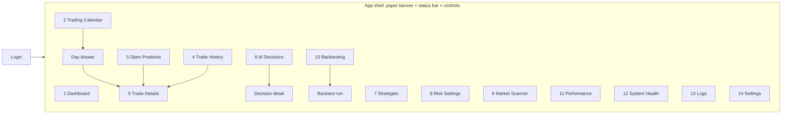

# 10 — UI Wireframes

Responsive SPA. Desktop is the primary layout; on phones the left nav becomes a bottom tab bar ("More" holds the rest), and tables collapse to cards.

## 1. Sitemap



## 2. App shell (every page)

```
┌──────────────────────────────────────────────────────────────────────────────┐
│ ███  PAPER TRADING — NO REAL MONEY  ███          (amber, sticky, not closable) │
├──────────────────────────────────────────────────────────────────────────────┤
│ Intraday   TRADING MODE: PAPER   ● RUNNING   Mkt open 14:02 ET   AI: OFF     │
│            Daily loss used $120 / $500 ▓▓░░░░░░      [ PAUSE ] [ EMERGENCY STOP ]│
├──────────┬───────────────────────────────────────────────────────────────────┤
│ Dashboard│                                                                   │
│ Calendar │                        page content                               │
│ Positions│                                                                   │
│ History  │                                                                   │
│ Decisions│                                                                   │
│ Strategies                                                                   │
│ Risk     │                                                                   │
│ Scanner  │                                                                   │
│ Backtest │                                                                   │
│ Perform. │                                                                   │
│ Health   │                                                                   │
│ Logs     │                                                                   │
│ Settings │                                                                   │
├──────────┴───────────────────────────────────────────────────────────────────┤
│ Trading involves substantial risk. This system does not guarantee profits or │
│ prevent losses. Paper-trading results may differ materially from live trading.│
└──────────────────────────────────────────────────────────────────────────────┘
```

- The status pill's colour and text follow the gate (07 §6). Hovering or tapping lists every active block reason with its start time.
- The status bar shows START instead of PAUSE while paused. If a latch is active, START is disabled with a tooltip explaining why, and a **RESET** button appears.
- A disconnected WebSocket shows a small "live updates paused — polling" chip.
- Unacknowledged HIGH/CRITICAL alerts appear as a red bar under the status bar until acknowledged.

### Control confirmations

| Control | Confirmation |
|---|---|
| PAUSE / START | One click (START shows a summary of active limits first) |
| EMERGENCY STOP | Modal: "Cancel all entry orders and **close all positions**" (default from settings; checkbox to keep positions instead) + type `EMERGENCY STOP` |
| CLOSE ALL | Modal + type `CLOSE ALL` |
| Close position | Modal + type the symbol |
| RESET DAILY LOCK / latch | Modal showing today's P&L and cause + type `RESET` + password |

## 3. Dashboard (1)

```
┌ Account ───────────┬ Today ─────────────┬ Totals ──────────────┬ Status ─────────┐
│ Value   $100,412.20 │ P&L      +$184.25  │ Total P&L  +$412.20  │ ● RUNNING       │
│ Cash     $62,300.00 │ Trades 7  W5 / L2  │ Win rate (30d) 54%   │ Open pos 3 / 5  │
│ Buying P $250,000   │ Win rate 71%       │                      │ Exposure $31.2k │
│                     │ Loss limit $500    │                      │   / $50k        │
│                     │ Loss used  $0 ░░░░ │                      │ Trades 7 / 20   │
└─────────────────────┴────────────────────┴──────────────────────┴─────────────────┘
┌ Intraday equity (line) ──────────────────────┐┌ Open positions (compact) ─────────┐
│      ╱╲    ╱‾‾                                ││ NVDA  +$41.20  +0.8%  VWAP Recl.  │
│ ‾‾‾‾╱  ╲__╱                                   ││ AMD   −$12.10  −0.3%  Breakout    │
└───────────────────────────────────────────────┘│ MSFT  +$8.00   +0.1%  Pullback    │
┌ Recent decisions ─────────────────────────────┐└───────────────────────────────────┘
│ 14:01 AMD  BUY  0.78 Breakout  → SUBMITTED    │┌ Alerts ───────────────────────────┐
│ 13:58 TSLA BUY  0.72 Pullback  → RISK_REJECTED││ 13:40 WARN IEX quote stale: CRM   │
│        (R20 sector exposure)                  ││                                    │
└───────────────────────────────────────────────┘└───────────────────────────────────┘
```

## 4. Trading Calendar (2): the key page (SPEC §19, §43)

```
  ◀  September 2026  ▶                                   Month: +$1,284.50 · 19 days
┌─────────┬─────────┬─────────┬─────────┬─────────┐
│ Mon     │ Tue     │ Wed     │ Thu     │ Fri     │
├─────────┼─────────┼─────────┼─────────┼─────────┤
│ 31      │ 1       │ 2       │ 3       │ 4       │
│         │ +$82.00 │ −$31.40 │ +$124.1 │ +$45.00 │
│         │ 5 tr    │ 4 tr    │ 8 tr    │ 3 tr    │  green / red / gray cells
├─────────┼─────────┼─────────┼─────────┼─────────┤
│ 7 HOLID.│ 8 …     │         │         │         │  gray = no trading / holiday
└─────────┴─────────┴─────────┴─────────┴─────────┘
Hover/tap a cell: realized P&L, trades, W/L, win rate, largest win/loss, volume
```

Clicking a day opens a drawer (a full page on mobile):

```
September 21 ─────────────────────────────────────────── [×]
Daily P&L +$123.45   Trades 8   Winning 5   Losing 3   Win 62%
Largest win +$51.22   Largest loss −$12.45   Shares 1,840
┌──────┬──────────┬──────────┬──────────┬───────────┐
│ AAPL │ BUY 10:14│ SELL10:42│ +$42.10  │ VWAP Recl.│ ▸
│ NVDA │ BUY 11:02│ SELL11:31│ +$51.22  │ Breakout  │ ▸
│ MSFT │ BUY 13:22│ SELL13:39│ −$12.45  │ Pullback  │ ▸
│ …    │          │          │          │           │
└──────┴──────────┴──────────┴──────────┴───────────┘
```

Clicking a row goes to Trade Details.

## 5. Open Positions (3)

Table columns follow SPEC §21: Symbol · Price · Qty · Entry · Current · Unrealized P&L · P&L % · Stop · Target · Confidence · Strategy · Holding time · [Close]. The stop cell shows a ↑ badge once the trailing stop is active. There are no controls to edit stops or disable risk here (SPEC §21).

## 6. Trade History (4)

Filter bar: date range · symbol · strategy · win/loss · P&L range · confidence range · entry-time window · exit-time window · exit reason · [Export CSV]. The table is paginated and sortable, and each row links to Trade Details.

## 7. Trade Details (5): the full audit chain (SPEC §17, §43, §44)

```
AAPL · VWAP Reclaim · Sep 21, 2026                          Net P&L +$42.10 (+2.10%)
┌ Summary ─────────────────────────┐┌ Chart (1-min candles, VWAP, EMA9/20) ─────────┐
│ Entry  10:14:32 AM  @ $200.12    ││   ▲ entry        ── stop ── target            │
│ Exit   10:42:11 AM  @ $204.33    ││                          ▼ exit              │
│ Quantity 10                      ││                                               │
│ Gross +$42.10  Fees $0.00        │└───────────────────────────────────────────────┘
│ Net   +$42.10  Return +2.10%     │
│ Stop $198.12 → $202.40 (trailed) │
│ Target $204.12                   │
│ Model confidence 81%             │
└──────────────────────────────────┘
┌ Why did it enter? ──────────────────────────── (template | LLM-rephrased tag) ─┐
│ • Price reclaimed VWAP (+0.21%) …   (09 §8)                                    │
┌ Why did it exit? ──────────────────────────────────────────────────────────────┐
│ • Take-profit limit filled at $204.33 (target $204.12)                         │
┌ Audit trail (expandable steps) ────────────────────────────────────────────────┐
│ 1 Market data     features snapshot (table)                                    │
│ 2 Strategy        conditions ✓/✗ with values; factor scores bar chart          │
│ 3 AI              mode OFF / EXPLAIN / VETO verdict + reasons + raw call link  │
│ 4 Risk engine     25 checks ✓/✗ with value vs limit; sizing bounds, binding one│
│ 5 Orders          entry bracket + legs, client_order_id, status timeline       │
│ 6 Broker          raw events (collapsible JSON)                                │
│ 7 Fills           time, qty, price                                             │
│ 8 Exit            reason, trigger values                                       │
└────────────────────────────────────────────────────────────────────────────────┘
```

## 8. AI Decisions (6)

A table of `ai_decisions` with columns time · symbol · strategy · score · result (SUBMITTED / VETOED / RISK_REJECTED / BLOCKED) · reason summary. Filters cover result, strategy, symbol and date. Opening a row shows the decision detail, which reuses steps 1–4 of the Trade Details audit trail. A counter strip shows the day's funnel: evaluated → proposals → vetoed → risk-rejected → submitted → filled.

## 9. Strategies (7)

One card per strategy: enabled toggle, parameters (a form generated from the settings schema) and stats for today and the last 30 days (trades, win rate, net P&L, profit factor). Saving goes through the settings workflow (06 §4), so it's versioned and audited.

## 10. Risk Settings (8)

A form covering the risk, exits and hours groups. Each field shows the current value, default, hard bound, and whether changing it counts as tightening or loosening. Loosening fields are disabled while the engine is RUNNING, with a banner: "Pause trading to loosen risk limits." Saving opens a review modal listing the diff, then asks for confirmation and a comment. Locked fields (short selling, fractional, bar interval) display read-only with the reason.

## 11. Market Scanner (9)

A watchlist table with columns symbol · price · pass/fail (reasons on hover) · RVOL · spread % · VWAP dist · ATR% · best strategy · score · news tags · regime chip in the header. It updates each bar. The watchlist editor lives here too. Its fields are symbol, asset type, country, sector, sector ETF and market cap. Each entry shows an eligibility badge with E1–E7 results on hover (07 §2a), and an ineligible symbol can't be saved as tradable. Context symbols (SPY, QQQ, sector ETFs, volatility proxy) appear in a separate read-only "Market context" section labelled *not tradable*. A stream-budget indicator shows usage, e.g. "22 / 30 streamed symbols".

## 12. Backtesting (10)

New run form: symbols (default watchlist) · train / validation / test date ranges · starting capital · strategies · risk overrides · costs & slippage. The data-coverage check runs before submission, and gaps come with a "Backfill" button. The run page shows metrics per split side by side (total/annualized return, max DD, Sharpe, Sortino, win rate, profit factor, avg win/loss, largest loss, streaks, trades, avg holding), an equity curve with drawdown shading, and a trades table. Out-of-sample results are visually emphasised, with a banner warning against tuning on the test split.

## 13. Performance (11)

Period selector (day/week/month/custom). KPI tiles and charts: daily/weekly/monthly P&L bars, cumulative P&L, drawdown, and breakdowns by strategy, symbol, time-of-day (hour buckets) and exit reason. A confidence-vs-outcome chart shows score buckets against win rate and avg P&L. Sharpe is labelled as computed from daily paper returns.

## 14. System Health (12)

A component grid: Engine heartbeat · Broker REST · Broker stream · Market data (per-symbol freshness heatmap) · Database · Redis · AI provider (only if mode ≠ OFF) · Scheduler (next jobs) · Backups (last success). Each tile shows state, latency and last error. Below the grid are order latency p50/p95, rejection rate today, and CPU/memory/disk per container.

## 15. Logs (13)

A unified, filterable stream of system_events, risk_events and audit_log (component, severity, text search, date). JSON details are expandable. Alerts have their own tab with acknowledge buttons.

## 16. Settings (14)

Everything not covered by Strategies/Risk: universe filters, scoring weights (sliders with live sum = 1.00 check), regime policies, AI mode / model / timeout (disabled with an explanation if no API key), data feed (restart-required badge), news, execution, alerts/email (plus a test-email button). Also settings history with diffs and rollback, import/export YAML, and account (change password, sessions).
