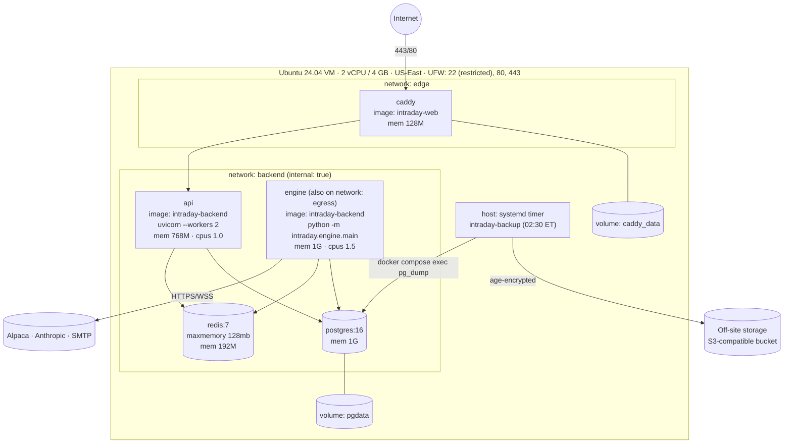

# 11 — Docker Architecture

## 1. Deployment view (production VM)



- `backend` is `internal: true`, so containers on it have no internet route. The engine additionally joins `egress`, which makes it the only container that can reach the internet. Caddy joins `edge` and `backend` and forwards only to `api`.
- No database or Redis port is published on the host. Dev overrides publish them on `127.0.0.1` only.
- Memory budget: 128M + 768M + 1G + 1G + 192M ≈ 3.1 GB, leaving about 0.9 GB for the OS and page cache on a 4 GB VM. A 2 GB swap file is a safety net.

## 2. Services (`compose.yaml`)

| Service | Image | Command | Restart | Healthcheck | Depends on |
|---|---|---|---|---|---|
| `caddy` | `intraday-web` (caddy:2 + built SPA) | default | `unless-stopped` | `wget -qO- localhost:2019/config/` | api (started) |
| `api` | `intraday-backend` | `uvicorn intraday.api.main:app --host 0.0.0.0 --port 8000 --workers 2 --proxy-headers` | `unless-stopped` | `GET /api/v1/health/ready` | postgres, redis (healthy) |
| `engine` | `intraday-backend` | `python -m intraday.engine.main` | `unless-stopped` | `intraday healthcheck` (heartbeat < 15 s) | postgres (healthy), redis (started) |
| `postgres` | `postgres:16-alpine` (pinned digest) | default + tuned conf | `unless-stopped` | `pg_isready` | — |
| `redis` | `redis:7-alpine` (pinned digest) | `--maxmemory 128mb --maxmemory-policy allkeys-lru --save ""` | `unless-stopped` | `redis-cli ping` | — |

Engine specifics:
- `stop_grace_period: 60s`. SIGTERM makes the engine stop accepting new entries, finish in-flight submissions, flush the spool and exit. It **does not** flatten positions on shutdown; brackets at the broker protect them, and the reconciler adopts them on restart.
- `depends_on redis: service_started` rather than healthy, because the engine must run even when Redis is degraded.
- It is the only service whose `environment:` block receives the Alpaca and Anthropic keys. `compose.yaml` passes each service an explicit list of variables from `.env` (Compose variable substitution) instead of the whole file, so the API never sees broker keys. *(Phase 1: replaces the per-service `.env.api` / `.env.engine` files first planned here.)*

## 3. Images

**intraday-backend** (multi-stage):
1. `builder`: `python:3.12-slim` + uv, `uv sync --frozen --no-dev` into `/opt/venv`.
2. `runtime`: `python:3.12-slim`, copy the venv and `src/`, non-root user `app` (uid 10001), read-only root FS (`read_only: true` + `tmpfs: /tmp`), `PYTHONDONTWRITEBYTECODE=1`. The engine gets a small writable volume `engine_spool` for the DB-outage spool (01 §6).

**intraday-web**:
1. `node:22-alpine`: `npm ci && npm run build` (OpenAPI types generated at build time from a committed `openapi.json` snapshot).
2. `caddy:2-alpine`: copy `dist/` to `/srv`, copy `Caddyfile`.

Both images are built in CI on every push and tagged with the git SHA. Deployment builds on the VM from the same commit (no registry required), and a registry can be added later.

## 4. Caddyfile (outline)

```
{$PUBLIC_DOMAIN} {
    encode zstd gzip
    header {
        Strict-Transport-Security "max-age=31536000; includeSubDomains"
        Content-Security-Policy "default-src 'self'; connect-src 'self' wss://{$PUBLIC_DOMAIN}; img-src 'self' data:; style-src 'self' 'unsafe-inline'; frame-ancestors 'none'"
        X-Content-Type-Options nosniff
        Referrer-Policy no-referrer
    }
    handle /api/v1/metrics* { respond 404 }
    handle /api/* { reverse_proxy api:8000 }
    handle /ws    { reverse_proxy api:8000 }
    handle { root * /srv; try_files {path} /index.html; file_server }
}
```

## 5. Environments and compose files

| File | Purpose |
|---|---|
| `compose.yaml` | Production definition (the only deployed environment, CLAUDE.md) |
| `compose.dev.yaml` | Local dev on Docker Desktop (Windows/Mac): bind-mount `src/`, `uvicorn --reload`, engine with `watchfiles`, Vite dev server on :5173 proxying `/api` and `/ws`, Postgres/Redis on `127.0.0.1`, Caddy disabled. `ENGINE_BROKER=sim` lets the full stack run on replay data without Alpaca keys. |
| `compose.test.yaml` | Ephemeral Postgres + Redis (tmpfs) for integration tests and CI |

`ENGINE_BROKER=sim` is honoured **only** together with `ENGINE_DATA=replay`. It exists for dev and E2E runs, and the production `.env` never sets it. The broker factory refuses `sim` when `ENGINE_DATA=live`.

Typical commands:

```bash
docker compose -f compose.yaml -f compose.dev.yaml up --build          # dev
docker compose -f compose.test.yaml up -d && uv run pytest               # tests
docker compose up -d --build                                             # prod (on VM)
docker compose exec engine intraday replay --date 2026-09-21 --speed 60  # replay into intraday_sim
```

## 6. Backups (CLAUDE.md)

- `infrastructure/scripts/backup.sh`, run by the host systemd timer `intraday-backup.timer` at 02:30 ET daily:
  `docker compose exec -T postgres pg_dump -Fc -d intraday > /var/backups/intraday/intraday-YYYYMMDD.dump`.
- Retention: 14 daily + 8 weekly (Sunday) + 6 monthly, pruned by the same script.
- Off-site: each dump is `age`-encrypted with a public key and uploaded with `rclone` to an S3-compatible bucket. The private key is not on the VM.
- Success is written to a file the engine reads for the System Health "last backup" tile. A failure raises a HIGH alert, and a stale backup older than 36 h raises a WARN.
- `restore.sh` and a runbook, `docs/runbooks/restore.md`, are **tested in Phase 13** by restoring into a scratch database and running row-count checks.

## 7. VM provisioning (Phase 14 outline)

1. Ubuntu 24.04 LTS, 2 vCPU / 4 GB, US-East (close to Alpaca's servers), encrypted disk.
2. `vm-bootstrap.sh`: create a non-root deploy user, SSH keys only, UFW (22 from your IP, 80, 443), unattended-upgrades, Docker Engine + Compose plugin, 2 GB swap, chrony (time sync matters for trading cutoffs), journald limits and Docker log rotation (`max-size 20m, max-file 5`).
3. DNS A record → VM, set `PUBLIC_DOMAIN`, and Caddy obtains certificates.
4. `.env*` files placed manually (chmod 600), then `docker compose up -d --build`, `intraday create-admin`, and `intraday backfill --days 30`.
5. Enable the backup timer. Run a restore test.

## 8. Upgrade procedure (runbook)

Upgrades happen outside market hours. Run `git pull`, then `docker compose build`, then `docker compose run --rm api alembic upgrade head`, then `docker compose up -d`. The engine reconciles on boot and comes up **PAUSED** if the previous state was paused. Migrations must be backward compatible for one release, so an engine restart during an upgrade doesn't break.
