# 12 — Development Roadmap

These phases are reordered from SPEC §45 (decision D4). Each phase ends with the same CLAUDE.md gate: **run tests → fix failures → summarise → list files changed → give run commands → STOP for approval.**

"Done" for each phase means its exit criteria are met, `ruff`, `mypy` and `import-linter` are clean, and every test named in the phase passes. No test calls a real external API.

## Overview

```mermaid
flowchart LR
    P0[0 Design ✔ review] --> P1[1 Foundation]
    P1 --> P2[2 Market data] --> P3[3 Scanner] --> P4[4 Indicators,<br/>strategies, scoring]
    P4 --> P5[5 Risk engine] --> P6[6 Backtest +<br/>SimBroker + replay]
    P6 --> P7[7 Paper broker] --> P8[8 Order/position<br/>mgmt + runtime]
    P8 --> P9[9 AI layer] --> P10[10 Dashboard UI]
    P10 --> P11[11 Calendar/P&L<br/>+ performance] --> P12[12 Monitoring/alerts]
    P12 --> P13[13 Prod hardening] --> P14[14 VM deploy] --> P15[15 E2E + validation]
```

| SPEC phase | Here | Change |
|---|---|---|
| 1 Architecture/repo/DB/config | 1 | Adds dev Compose, auth, paper guard, frontend shell |
| 2 Market data | 2 | + watchlist metadata, calendar |
| 3 Scanner | 3 | — |
| 4 Indicators | 4 | + regime, strategies, deterministic scoring (these were in SPEC phase 9) |
| 5 Backtesting | 6 | Moved after risk; + SimBroker + replay mode |
| 6 Risk engine | 5 | Moved before backtesting |
| 7 Paper broker | 7 | — |
| 8 Order/position mgmt | 8 | + engine runtime, reconciliation, EOD, controls |
| 9 AI decision engine | 9 | Narrowed to LLM layer (EXPLAIN/VETO), explanations, news |
| 10–12 | 10–12 | — |
| 13 Docker | 13 | Becomes production hardening (Compose exists from Phase 1) |
| 14 AWS deployment | 14 | Single-VM deployment (CLAUDE.md) |
| 15 E2E | 15 | + validation-stage checklist |

## Build status (2026-09-27)

| Phase | Status |
|---|---|
| 1–12 | Built and tested (automated) |
| 13 | Built; the local TLS stack run and restore test need Docker on your machine |
| 14 | Scripts and guide built (`docs/deploy.md`); running them needs your VM |
| 7/8 exit criteria | Replay runs the full pipeline (done). Manual paper checks during market hours and a supervised paper session are still to do |
| 15 | Built: Playwright suite (6 flows, full stack, replayed data) + failure-injection suite (SPEC §27) + engine replay; runs in CI |

## Phases

### Phase 1: Foundation
Repo skeleton (03); `pyproject`/uv, ruff, mypy, import-linter, pytest; `compose.yaml` + `compose.dev.yaml` + `compose.test.yaml` with postgres/redis/api/engine (the engine is a stub loop with heartbeat); Alembic migration for **all** tables in 04 plus DB roles; Pydantic settings model + `config/defaults.yaml` + hard limits + loosen/tighten comparators; settings API (get/validate/put/history/export/import); auth (argon2, sessions, CSRF, rate limit, audit log, `create-admin`); paper guard (`core/safety.py`) + `FutureLiveBroker` stub; engine_state + commands table plumbing; frontend shell (Vite/React/Tailwind, login, app shell with paper banner, status bar, disclaimer, Settings page rendering from schema); `.env.example`, `.gitignore`, secret-scan check, README skeleton, CI workflow.
**Exit:** `docker compose up` gives a working login, settings can be viewed, edited and versioned, and the engine heartbeat shows in the UI. Tests: config validation and bounds, loosening detection, paper guard cases, auth (hashing, lockout, CSRF, rate limit), migrations up/down.

### Phase 2: Market-data service
`MarketDataSource` interface; Alpaca historical (1-min + daily, feed-tagged) and streaming client; bar store; market calendar incl. early closes; data-quality checks; watchlist CRUD (TRADABLE + CONTEXT roles) + seed file + Alpaca asset sync; `core/assets.py` eligibility function (07 §2a); `intraday backfill`; stream-budget check; fake WS server for tests; Alpaca free-plan limits verified.
**Exit:** backfill 30 days for the watchlist and stream live bars into the DB. Tests: parsing from recorded fixtures, reconnect/backoff, stale detection, calendar edge cases (half-day, holiday, DST).

### Phase 3: Stock scanner
Universe filters (07 R5–R7 subset, 06 §3.4) with recorded reasons; `universe_scans`; `/scanner` + `/watchlist` endpoints; ADV threshold calibration note for IEX.
**Exit:** a scan runs on schedule and on demand, with reasons visible. Tests for each filter.

### Phase 4: Indicators, regime, strategies, scoring
Indicators (02 T8) with reference-value tests; feature engineering incl. same-feed RVOL; regime detector; Strategies A/B/C; `WeightedRuleScorer`; proposal model; template explanations; `trading_signals` persistence.
**Exit:** running over stored bars produces signals and proposals. Tests: reference indicator values, no-look-ahead, strategy fixtures, scorer properties, explanation rendering.

### Phase 5: Risk engine
All of 07: checks R1–R26 incl. asset eligibility (§2a), sizing, daily-loss monitor, correlation clusters, trading gate + latches, `risk_evaluations`.
**Exit:** risk tests pass, including the SPEC §5 example and hypothesis properties.

### Phase 6: Backtesting, SimBroker and replay
`SimBroker` (08 §10); backtest runner reusing strategies, scorer and risk; train/validation/test splits; costs and slippage; all SPEC §24 metrics; `backtest_*` tables; `/backtests` API (job in API process, one at a time); `intraday replay` driving the real engine runtime at accelerated speed against `intraday_sim`.
**Exit:** backtest over stored IEX history with metrics per split; replay a full day end-to-end with SimBroker. Tests: metric calculations on known series, no-look-ahead, conservative same-bar stop/target rule.

### Phase 7: Paper broker integration
`AlpacaPaperBroker` + factory guard + account checks (PA prefix, `no_shorting`); trade-updates stream; recorded fixtures for every order path. **Behaviour verified manually against the paper API** (bracket partial fills, leg replace, cancel races), with the results recorded as new fixtures. This is the only phase that touches the real paper API, and it's done by hand, never from tests.
**Exit:** a manual smoke script places, trails and cancels a 1-share bracket on paper during market hours.

### Phase 8: Order/position management and engine runtime
OrderManager (idempotency, state machine, retries), PositionManager, ExitEngine, Reconciler, Liquidator, scheduler jobs, command handling (START/PAUSE/EMERGENCY/CLOSE ALL/RESET), DB-outage spool, supervisor.
**Exit:** replay runs the full pipeline, and paper runs for one supervised session. Tests: every item in 08 §11 plus SPEC §38's list for this layer.

### Phase 9: AI layer
`AIProvider` + `AnthropicProvider` + `NullProvider` + stubs; VETO and EXPLAIN flows; number guard; data-minimisation test; news ingestion + event tags (+ LLM sentiment in VETO); `llm_calls`.
**Exit:** replay with each AI_MODE, where OFF and EXPLAIN produce identical trades. Fixtures cover malformed output, refusal, timeout and unavailable.

### Phase 10: Dashboard UI
Pages 1, 3, 4, 5, 6, 7, 8, 9, 14 with WebSocket live updates and controls with confirmations.
**Exit:** Vitest component tests pass, and a Playwright smoke run against the dev stack in replay mode succeeds.

### Phase 11: Calendar, P&L and performance
`daily_pnl` + `strategy_performance` maintenance; calendar API + page (2) with day drawer; Performance page (11); CSV export.
**Exit:** calendar numbers reconcile with trades (test), and the P&L math has unit tests.

### Phase 12: Monitoring and alerts
Metrics, System Health page (12), Logs page (13), alert dedupe/ack, notifier interface + dashboard + email (SMTP), all SPEC §26 alert types.
**Exit:** each alert type is raised in tests; test email via a local SMTP catcher.

### Phase 13: Production hardening
Caddy config and security headers; production compose (networks, limits, read-only FS, non-root); backup and restore scripts + systemd timer + tested restore; runbooks; dependency audit; security review (auth, CSRF, secrets, SSRF surfaces, the "no broker creds in API" check).
**Exit:** a prod-like stack runs locally with TLS (Caddy internal CA) and the restore test passes.

### Phase 14: VM deployment
Provisioning script, DNS/TLS, first deploy, admin creation, backfill, backup timer, off-site copy.
**Exit:** the app is live on the VM in paper mode and PAUSED, and one supervised paper session is completed.

### Phase 15: End-to-end testing
Playwright suite over the full stack in replay mode: login, start/pause, emergency stop, a trade appearing through calendar → day → detail, CSV export, settings loosening blocked while running, daily-loss lock and reset. Also a failure-injection suite (kill the engine mid-session, stop Postgres, drop the broker stream) asserting SPEC §27 behaviour.
**Exit:** all green. Hand-off to the validation stages.

## Validation stages (SPEC §25; not build phases, G12)

| Stage | Activity | Suggested gate to next stage |
|---|---|---|
| V1 Backtest review | OOS results per strategy with costs | You decide based on OOS metrics, not training metrics |
| V2 Paper trading | Automated paper sessions, daily review | ≥ 20 sessions without any unexplained reconciliation mismatch or failed liquidation |
| V3 Extended paper | ≥ 60 sessions | Stable risk behaviour; paper vs backtest divergence understood |
| V4 Review | Performance + risk review | Any move toward live trading is a **separate project** with its own safety review (SPEC §49). It is not part of this roadmap. |

## Risks to the plan

| Risk | Mitigation |
|---|---|
| IEX data too sparse for some symbols | Coverage filter, curated liquid watchlist; SIP is a setting |
| Alpaca bracket behaviours differ from assumptions (partial fills, leg replace) | Verified in Phase 7 with fallbacks already designed (08 §6, §7) |
| 2 vCPU contention during backtests | One backtest at a time, API CPU cap, run backtests outside market hours by default (UI warns) |
| Scope creep in UI | UI phases follow page list; polish after V2 |
